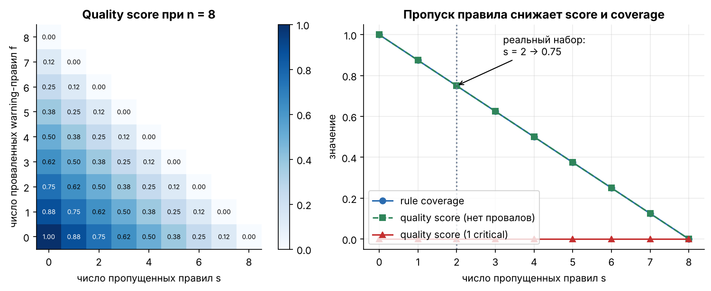

# 2. Правила качества и quality gate

## 2.1 Постановка

После SILVER каждый пакет проверяется набором правил из конфигурации (`backend/etl/config/default.yaml`). Результат — список исходов правил, по которому вычисляются три числа:

- **`quality_score`** — доля пройденных правил (с поправками, ниже);
- **`rule_coverage`** — доля правил, которые реально удалось выполнить;
- **статус пакета** `passed / warning / failed` (решение quality gate), от которого зависит, будет ли опубликован GOLD.

Код: `backend/etl/quality/rules.py`, `gate.py`, `reports.py`. Функции `quality_score`, `rule_coverage`, `evaluate_gate` — чистые Python-функции, поэтому ниже они вызываются в расчётах без изменений.

## 2.2 Правила как индикаторы нарушений

Пусть $\mathcal R=\{\rho_1,\dots,\rho_n\}$ — набор правил, $n=|\mathcal R|$. У каждого правила есть важность $\sigma(\rho)\in\{\text{critical},\text{warning},\text{info}\}$ и исход

$$
s(\rho)\in\{\text{passed},\ \text{failed},\ \text{skipped}\}.
$$

**Построчные правила.** Для правила $\rho$ с предикатом нарушения $\varphi_\rho$ число нарушений равно сумме индикаторов по строкам SILVER:

$$
f_\rho=\sum_{i=1}^{N}\varphi_\rho(r_i),\qquad s(\rho)=\text{failed}\iff f_\rho>0 .
$$

Предикаты (`row_failure_condition`):

| Правило | $\varphi_\rho(r_i)=1$, когда |
|---|---|
| `not_null` | $x_{ij}=\varnothing$ |
| `between(a,b)` | $x_{ij}\ne\varnothing$ и (значение не приводится к числу, или $x_{ij}<a$, или $x_{ij}>b$) |
| `allowed_values(V)` | $x_{ij}\neq\varnothing$ и $x_{ij}\notin V$ |
| `regex` | $x_{ij}\neq\varnothing$ и значение не совпадает с шаблоном |
| `valid_timestamp` | $x_{ij}\neq\varnothing$ и значение не разбирается как время |
| `not_in_future` | время $x_{ij}$ позже текущего момента |

В трёхзначной логике SQL условие с NULL даёт NULL, а не `false`. Код оборачивает предикат в `coalesce(condition, false)`, поэтому $\varphi_\rho\in\{0,1\}$ всегда определён, а пропуск не считается нарушением (кроме правила `not_null`, где это и есть нарушение).

**Правила уровня набора.**

$$
\texttt{min\_rows}:\ N<\theta;\qquad
\texttt{max\_null\_ratio}:\ \frac{\sum_i M_{ij}}{N}>\theta;\qquad
\texttt{row\_count\_change}:\ \frac{|N-N_{\text{prev}}|}{N_{\text{prev}}}>\theta;
$$

`unique(K)` нарушено, если $\sum_{\text{группы по }K}(\text{размер}-1)>0$, `required_columns` — если хотя бы один из требуемых столбцов отсутствует.

**Недоступное правило.** Если столбец, к которому привязано правило, отсутствует в данных, исход определяется важностью:

$$
s(\rho)=\begin{cases}\text{failed},&\sigma(\rho)=\text{critical},\\ \text{skipped},&\text{иначе.}\end{cases}
$$

Смысл: отсутствие данных для **критического** контроля нельзя считать успехом, а для некритического допустимо пропустить, но это должно быть видно в отчёте (через `rule_coverage`).

**Аддитивность подсчёта.** Все счётчики $f_\rho$ — суммы индикаторов, поэтому при разбиении таблицы на $k$ частей $f_\rho=\sum_{t=1}^{k} f_\rho^{(t)}$. Это позволяет считать все правила **за один проход** по данным (`df.agg(*aggregations)`), а не отдельным заданием на каждое правило. Сложность $O(N\cdot|\mathcal R|)$ по времени и $O(1)$ дополнительных проходов по данным.

**Границы числа строк в карантине.** Пусть $R_q$ — правила с флагом карантина, $Q=\{i:\max_{r\in R_q}\varphi_r(r_i)=1\}$. Тогда

$$
\max_{r\in R_q}f_r\ \le\ |Q|\ \le\ \sum_{r\in R_q}f_r .
$$

Левое неравенство: строка, нарушающая правило $r$, попадает в $Q$. Правое — граница объединения (union bound). Равенство справа достигается, когда нарушающие множества не пересекаются, равенство слева — когда одно содержится в другом. В текущей конфигурации карантинное правило одно (`ph_physical_range`), поэтому $|Q|=f_{\texttt{ph\_physical\_range}}$ точно.

## 2.3 Метрики качества

Пусть $P$, $F$, $S$ — числа правил со статусами passed, failed, skipped ($P+F+S=n$), а $F_c$ — число проваленных критических правил.

$$
\boxed{\;C=\frac{P+F}{n}=1-\frac Sn\;}\qquad
\boxed{\;Q=\begin{cases}0,& n=0\ \text{или}\ F_c\ge1,\\[2pt] P/n,&\text{иначе.}\end{cases}\;}
$$

$C$ — `rule_coverage`, $Q$ — `quality_score` (в коде оба округляются до 4 знаков).

**Решающая функция quality gate.** Введём уровни $\ell(\text{info})=0$, $\ell(\text{warning})=1$, $\ell(\text{critical})=2$. Тогда

$$
G=\begin{cases}\text{warning},& P+F=0\ \ (\text{ни одно правило не выполнено}),\\[2pt]
\text{failed},& \max_{\rho:\,s(\rho)=\text{failed}}\ell(\sigma(\rho))=2,\\
\text{warning},& \max\ell=1,\\
\text{passed},& \text{иначе (нет провалов либо провалены только info).}\end{cases}
$$

(Ветка $P+F=0$ проверяется первой, как в `evaluate_gate`.)

## 2.4 Свойства метрик

**Теорема 2.1 (границы).** $0\le Q\le C\le1$.

*Доказательство.* $C=(P+F)/n\le1$ и $C\ge0$, так как $P+F\le n$. Если $F_c\ge1$ или $n=0$, то $Q=0\le C$. Иначе $Q=P/n\le(P+F)/n=C$. $\square$

**Теорема 2.2 (когда $Q=C$).** Если $F_c=0$, то $Q=C\iff F=0$.

*Доказательство.* $P/n=(P+F)/n\iff F=0$. $\square$

То есть score и coverage расходятся ровно на долю проваленных правил: $C-Q=F/n$ при $F_c=0$.

**Теорема 2.3 (поведение при ухудшении).** Пусть $F_c=0$ до и после изменения одного правила. Тогда:

| Переход | $\Delta Q$ | $\Delta C$ |
|---|---|---|
| passed → failed | $-1/n$ | $0$ |
| passed → skipped | $-1/n$ | $-1/n$ |
| skipped → passed | $+1/n$ | $+1/n$ |
| skipped → failed | $0$ | $+1/n$ |
| failed → passed | $+1/n$ | $0$ |

*Доказательство.* Подстановка в $Q=P/n$ и $C=(P+F)/n$: $P$ и $P+F$ меняются на $\pm1$ или $0$ соответственно. $\square$

Из таблицы видно содержательное свойство: **пропуск правила наказывается так же, как его провал** (оба уменьшают $Q$ на $1/n$), поэтому нельзя «улучшить» оценку, отключив неудобное правило. Но коэффициент $C$ отличает эти два случая.

**Утверждение 2.4 (разрыв в критическом провале).** Если один критический провал происходит при $P=n-1$, то $Q$ меняется скачком с $(n-1)/n$ на $0$.

Это не ошибка, а свойство дизайна: $Q$ отвечает на вопрос «можно ли доверять пакету», поэтому он по определению не гладкий. Как непрерывный регрессор (например, в модели прогноза качества данных) он непригоден, для этого нужны $P/n$ и $F_c$ по отдельности.

**Утверждение 2.5 (монотонность статуса).** Ухудшение исхода любого правила (passed → failed) не может улучшить статус $G$ в порядке $\text{passed}\prec\text{warning}\prec\text{failed}$.

*Доказательство.* Для $P+F\ge1$ значение $G$ определяется максимумом уровней $\ell$ среди проваленных правил, а добавление правила в множество проваленных не уменьшает максимум. Если до изменения $P+F=0$ (статус warning), то после изменения $F\ge1$, и статус не ниже warning. $\square$

**Замечание (info-правила).** Провал правила с $\sigma=\text{info}$ уменьшает $Q$, но не меняет $G$: уровень 0 неотличим от отсутствия провалов. Это значит, что `quality_score` и статус пакета могут «расходиться»: можно иметь $Q<1$ и статус `passed`.

## 2.5 Расчёт на реальных данных

Набор `water_potability.csv`, конфигурация `default.yaml` (8 правил). Результат (скрипт `s01_quality_score.py`, `results/01_quality_score.json`):

| Правило | Важность | Исход | Комментарий |
|---|---|---|---|
| `dataset_not_empty` | critical | passed | $N=3276\ge1$ |
| `ph_physical_range` | warning | passed | $\min=0$, $\max=14$, нарушений нет |
| `hardness_non_negative` | warning | passed | $\min=47.4$ |
| `turbidity_non_negative` | warning | passed | $\min=1.45$ |
| `conductivity_non_negative` | warning | passed | $\min=181.5$ |
| `temperature_physical_range` | warning | **skipped** | в наборе нет столбца `temperature` |
| `ph_null_ratio` | warning | passed | $491/3276=0.1499\le0.5$ |
| `measured_at_not_in_future` | warning | **skipped** | в наборе нет столбца `measured_at` |

$P=6,\ F=0,\ S=2,\ n=8$, поэтому

$$
C=\frac{6}{8}=0.75,\qquad Q=\frac68=0.75,\qquad G=\text{passed}.
$$

Скрипт вызывает код проекта и получает те же значения: `quality_score = 0.75`, `rule_coverage = 0.75`, `critical_failures = 0`, статус `passed`. Равенство $Q=C$ — частный случай теоремы 2.2 ($F=0$).

**Чувствительность.** Что будет, если на этом наборе проваливается один warning-контроль, а два остаются пропущенными: $F=1,\ P=5,\ S=2$ → $Q=5/8=0.625$, $C=6/8=0.75$, $G=\text{warning}$. Если провалился критический контроль: $Q=0$, $G=\text{failed}$.

*Рис. 2.1. Слева: $Q$ как функция числа проваленных warning-правил $f$ и пропущенных $s$ при $n=8$: $Q=(8-f-s)/8$, линии уровня — антидиагонали. Справа: $C$ и $Q$ при росте числа пропущенных правил; один критический провал обнуляет $Q$ при любом $s$. Вертикальная линия — реальный набор ($s=2$, $Q=C=0.75$).*

## 2.6 Вывод для работы

1. `quality_score` и `rule_coverage` — две проекции одного набора исходов, причём $Q\le C$ и разность $C-Q$ равна доле проваленных правил (при отсутствии критических провалов). Поэтому их полезно показывать **вместе**: низкий $Q$ при высоком $C$ означает «правила выполнены, данные плохие», а низкие $Q$ и $C$ вместе — «проверять нечем».
2. Отключить правило, чтобы улучшить оценку, нельзя: пропуск наказывается так же, как провал.
3. На тестовом наборе пакет получил статус `passed`, хотя покрытие всего $0.75$. Решающая функция $G$ не учитывает $C$, поэтому «зелёный» статус при неполном покрытии возможен.

## 2.7 Ограничения и рекомендации

- Статус $G$ не зависит от $C$. Естественное усиление — порог покрытия: $G=\text{warning}$, если $C<C_{\min}$ (например, $0.8$). Для тестового набора это превратило бы `passed` в `warning` и сделало бы видимым отсутствие столбцов времени и температуры.
- Все правила имеют одинаковый вес $1/n$ в $Q$. Это упрощение: пропуск контроля кислотности и пропуск контроля даты влияют на оценку одинаково. Взвешенный вариант $Q_w=\sum_\rho w_\rho\,\mathbf 1[s(\rho)=\text{passed}]/\sum_\rho w_\rho$ сохраняет теоремы 2.1–2.3 с заменой $1/n$ на $w_\rho/\sum w$.
- Допустимые диапазоны (`between`) — физические границы достоверности, а не санитарные нормы (см. `water_stats.thresholds`). Выход за диапазон помечает запись как недостоверную, но не говорит о качестве воды.
- В конфигурации верхняя граница температуры 100, в `docs/DATA_DICTIONARY.md` указано 60. Для воды это разные утверждения, и значения стоит привести в соответствие.
