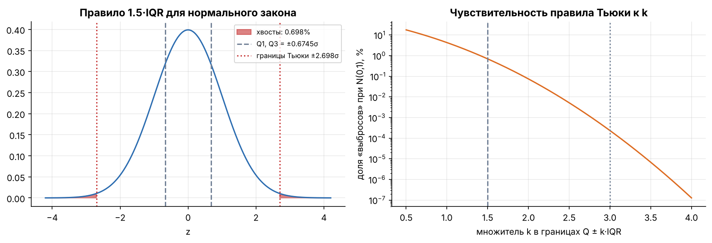
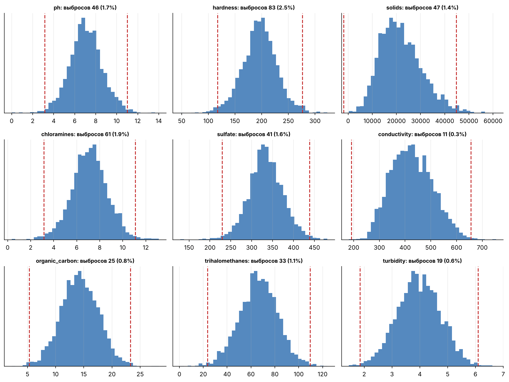
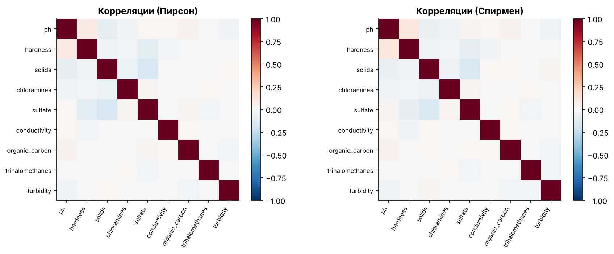

# 3. Описательная статистика, выбросы и корреляции

## 3.1 Постановка

Сервис аналитики (`backend/analytics/water_stats.py`) для каждого параметра считает среднее, стандартное отклонение, перцентили, гистограмму и границы Тьюки, а также матрицу корреляций Пирсона или Спирмена. Раздел формализует эти величины, выводит свойства правила Тьюки и оценивает, насколько они согласуются с реальными данными `water_potability.csv`.

Для параметра $j$ все формулы применяются к вектору $x_{(j)}=(x_{ij})_{i:\,x_{ij}\neq\varnothing}$ длины $n_j$ (пропуски отбрасываются).

## 3.2 Выборочные статистики

$$
\bar x=\frac1{n}\sum_{i=1}^{n}x_i,\qquad
s^2=\frac1{n-1}\sum_{i=1}^{n}(x_i-\bar x)^2,\qquad s=\sqrt{s^2}.
$$

В `distribution` используется `std(ddof=1)`, то есть именно $s$.

**Утверждение 3.1 (несмещённость $s^2$).** Если $x_i$ независимы с $\mathbb E x_i=\mu$, $\mathrm{Var}\,x_i=\sigma^2$, то $\mathbb E s^2=\sigma^2$.

*Доказательство.* Воспользуемся тождеством $\sum(x_i-\bar x)^2=\sum(x_i-\mu)^2-n(\bar x-\mu)^2$. Тогда
$\mathbb E\sum(x_i-\bar x)^2=n\sigma^2-n\cdot\sigma^2/n=(n-1)\sigma^2$. Деление на $n-1$ даёт $\mathbb E s^2=\sigma^2$. $\square$

Сама $s$ — смещённая оценка $\sigma$ (по неравенству Йенсена $\mathbb E s\le\sqrt{\mathbb E s^2}=\sigma$), но при $n\sim10^3$ смещение порядка $\sigma/(4n)$ пренебрежимо.

*Замечание по коду.* В `AnomalyDetector._training_stats` (`backend/ml/model.py`) используется `values.std()` с `ddof=0`. Отношение двух оценок равно $\sqrt{n/(n-1)}$, при $n=2\,000$ это $1.0003$, поэтому на значения `deviation_sigma` в объяснениях аномалий различие не влияет, но формально стоит унифицировать.

## 3.3 Квантили и гистограмма

Для упорядоченной выборки $x_{(1)}\le\dots\le x_{(n)}$ квантиль уровня $p$ (линейная интерполяция, `numpy` по умолчанию, тип 7 по Хиндману–Фэню):

$$
Q_p=x_{(\lfloor h\rfloor)}+(h-\lfloor h\rfloor)\bigl(x_{(\lfloor h\rfloor+1)}-x_{(\lfloor h\rfloor)}\bigr),\qquad h=(n-1)p+1 .
$$

Квартили $Q_1=Q_{0.25}$, $Q_3=Q_{0.75}$, межквартильный размах $\mathrm{IQR}=Q_3-Q_1$. Перцентили в API: $p\in\{0.01,0.05,0.25,0.5,0.75,0.95,0.99\}$.

Гистограмма с $b=20$ равными по ширине бинами на $[\min x,\max x]$: $\text{counts}_k=\#\{i:\,x_i\in[e_{k-1},e_k)\}$, последний бин замкнут справа.

**Устойчивость.** Медиана и $\mathrm{IQR}$ имеют точку разрыва (breakdown point) $50\%$ и $25\%$ соответственно: выбросов должно быть не меньше этой доли, чтобы сдвинуть оценку в бесконечность. Для $\bar x$ и $s$ она равна $0$: одно экстремальное значение сдвигает обе оценки сколь угодно далеко. Это основной аргумент в пользу правила Тьюки в роли «первого» детектора выбросов.

## 3.4 Правило Тьюки

Границы $[\,Q_1-k\cdot\mathrm{IQR},\ Q_3+k\cdot\mathrm{IQR}\,]$ с $k=1.5$ (`distribution`); значение вне границ считается выбросом (`boxplot.outliers`).

**Теорема 3.2 (границы Тьюки для нормального закона).** Для $X\sim\mathcal N(\mu,\sigma^2)$ границы Тьюки при $k=1.5$ равны $\mu\pm2.698\,\sigma$, а вероятность выхода за них

$$
p_{\mathrm T}=2\bigl(1-\Phi(2.698)\bigr)=0.00698 .
$$

*Доказательство.* Для стандартного нормального закона $Q_3=\Phi^{-1}(0.75)=0.6745$, $Q_1=-0.6745$, $\mathrm{IQR}=1.3490$. Верхняя граница: $Q_3+1.5\cdot\mathrm{IQR}=0.6745+2.0235=2.6980$, нижняя симметрична. Для общего $\mathcal N(\mu,\sigma^2)$ квантили равны $\mu+\sigma\Phi^{-1}(p)$, поэтому всё масштабируется на $\sigma$. Вероятность выхода — удвоенный хвост: $2\,(1-\Phi(2.698))=0.00698$ (численно: `scipy.stats.norm.sf`). $\square$

Для сравнения правило «3 сигма»: $p_{3\sigma}=2(1-\Phi(3))=0.0027$. Правило Тьюки при $k=1.5$ строже: на нормальных данных оно помечает $0.70\%$ значений против $0.27\%$ у «3σ».

**Общая формула для $k$:** $p_{\mathrm T}(k)=2\bigl(1-\Phi(0.6745+2k\cdot0.6745)\bigr)$. При $k=3$ («дальние выбросы»): границы $\pm4.72\sigma$, $p\approx2.4\cdot10^{-6}$.

*Рис. 3.1. Слева: плотность $\mathcal N(0,1)$, квартили $\pm0.6745$ и границы Тьюки $\pm2.698$, закрашенные хвосты составляют 0.698 %. Справа: доля «выбросов» при нормальных данных как функция множителя $k$ (лог-шкала).*

**Z-оценка.** $z_i=(x_i-\bar x)/s$, выброс при $|z_i|>3$. Для $m$ параметров в экспериментах используется оценка $\max_j|z_{ij}|$ (раздел 5).

### Совокупная доля выбросов по нескольким параметрам

Если строка помечается, когда выброс найден **хотя бы в одном** из $m$ параметров, то при независимых нормальных параметрах доля помеченных строк равна

$$
1-(1-p)^m .
$$

Для $m=9$: правило Тьюки $1-(1-0.00698)^9=6.10\%$ (ожидаемо $\approx200$ строк из 3 276), правило «3σ» $1-(1-0.0027)^9=2.40\%$ (ожидаемо $\approx79$ строк). Наблюдаемые значения см. в таблице ниже. Это важное свойство: **доля ложных срабатываний растёт с числом параметров**, поэтому порог для строки целесообразно задавать числом нарушенных параметров или оценкой многомерного детектора (раздел 4), а не «хотя бы одним».

## 3.5 Расчёт на реальных данных

Скрипт `s02_descriptive_outliers.py`, результаты в `results/02_descriptive_outliers.json`.

| Параметр | $n_j$ | пропусков | $\bar x$ | $s$ | $Q_1$ | медиана | $Q_3$ | границы Тьюки | выбросов Тьюки (доля) | $\lvert z\rvert>3$ | асимметрия | эксцесс |
|---|---|---|---|---|---|---|---|---|---|---|---|---|
| ph | 2 785 | 491 | 7.08 | 1.59 | 6.09 | 7.04 | 8.06 | [3.14; 11.02] | 46 (1.65 %) | 16 | 0.03 | 0.72 |
| hardness | 3 276 | 0 | 196.4 | 32.9 | 176.9 | 197.0 | 216.7 | [117.1; 276.4] | 83 (2.53 %) | 18 | −0.04 | 0.61 |
| solids | 3 276 | 0 | 22 014 | 8 769 | 15 667 | 20 928 | 27 333 | [−1 832; 44 832] | 47 (1.43 %) | 20 | 0.62 | 0.44 |
| chloramines | 3 276 | 0 | 7.12 | 1.58 | 6.13 | 7.13 | 8.12 | [3.15; 11.10] | 61 (1.86 %) | 20 | −0.01 | 0.59 |
| sulfate | 2 495 | 781 | 333.8 | 41.4 | 307.7 | 333.1 | 360.0 | [229.3; 438.3] | 41 (1.64 %) | 17 | −0.04 | 0.64 |
| conductivity | 3 276 | 0 | 426.2 | 80.8 | 365.7 | 421.9 | 481.8 | [191.7; 655.9] | 11 (0.34 %) | 7 | 0.26 | −0.28 |
| organic_carbon | 3 276 | 0 | 14.29 | 3.31 | 12.07 | 14.22 | 16.56 | [5.33; 23.30] | 25 (0.76 %) | 4 | 0.03 | 0.04 |
| trihalomethanes | 3 114 | 162 | 66.40 | 16.18 | 55.85 | 66.62 | 77.34 | [23.61; 109.58] | 33 (1.06 %) | 12 | −0.08 | 0.24 |
| turbidity | 3 276 | 0 | 3.97 | 0.78 | 3.44 | 3.96 | 4.50 | [1.85; 6.09] | 19 (0.58 %) | 8 | −0.01 | −0.06 |

**Что показывают числа.**

1. **Доля выбросов по Тьюки выше теоретической $0.70\%$** у шести из девяти параметров (1.1–2.5 %), а у `conductivity`, `organic_carbon` и `turbidity` близка или ниже (0.34 %, 0.76 %, 0.58 %). Закономерность связана с эксцессом: у параметров с избыточным эксцессом около $0.6$ (`ph`, `hardness`, `chloramines`, `sulfate`) хвосты тяжелее нормальных. Для иллюстрации возьмём распределение Стьюдента с $\nu=14$ степенями свободы (избыточный эксцесс $6/(\nu-4)=0.6$): для него границы Тьюки равны $\pm4\cdot t_{0.75}(14)=\pm2.77$ масштаба, а вероятность выхода $1.5\%$ — то есть тот же порядок, что наблюдается (1.6–2.5 %). Полностью объяснить `hardness` (2.53 %) этим нельзя; остаётся влияние формы хвостов, отличной от $t$.
2. **Асимметрия.** Явная только у `solids` ($0.62$): нижняя граница Тьюки отрицательна ($-1\,832$), что физически бессмысленно (содержание растворённых веществ не может быть отрицательным), поэтому на нижнем хвосте правило Тьюки ничего не найдёт, а на верхнем пометит правый хвост. Для таких параметров логарифмическое преобразование или границы по перцентилям были бы корректнее.
3. **Совокупная доля.** Строк, в которых хотя бы один параметр вне границ Тьюки, 325 (9.9 %) при ожидаемых $\approx200$ (6.1 %) для независимых нормальных параметров. Для правила «3σ» таких строк 115 (3.5 %) при ожидаемых $\approx79$ (2.4 %). Превышение объясняется тяжёлыми хвостами из п. 1.
4. **Нормальность.** Критерий Д'Агостино $K^2$ отвергает нормальность при $\alpha=0.05$ для семи параметров из девяти (минимальное $p=6\cdot10^{-44}$ у `solids`) и не отвергает для `organic_carbon` ($p=0.72$) и `turbidity` ($p=0.76$). При $n\approx3000$ критерий очень чувствителен: даже эксцесс $0.6$ даёт крошечное $p$, поэтому практическая значимость определяется не $p$, а размером отклонения (эксцесс до $0.7$, асимметрия до $0.6$ — умеренные).

*Рис. 3.2. Гистограммы девяти параметров, штриховые линии — границы Тьюки, в заголовке число и доля выбросов.*

## 3.6 Корреляции

**Коэффициент Пирсона.**

$$
r_{ab}=\frac{\sum_i(a_i-\bar a)(b_i-\bar b)}{\sqrt{\sum_i(a_i-\bar a)^2}\ \sqrt{\sum_i(b_i-\bar b)^2}} .
$$

**Утверждение 3.3.** $|r_{ab}|\le1$, причём $|r_{ab}|=1$ тогда и только тогда, когда $b_i=\alpha a_i+\beta$ для некоторых $\alpha\ne0$, $\beta$.

*Доказательство.* Положим $u_i=a_i-\bar a$, $v_i=b_i-\bar b$. По неравенству Коши–Буняковского $\bigl(\sum u_iv_i\bigr)^2\le\sum u_i^2\sum v_i^2$, откуда $|r|\le1$; равенство достигается ровно при пропорциональности векторов $u$ и $v$, то есть при линейной зависимости $b_i=\alpha a_i+\beta$. $\square$

**Коэффициент Спирмена** $\rho_{ab}$ — коэффициент Пирсона, вычисленный по рангам. Он инвариантен к любому строго монотонному преобразованию каждого параметра и поэтому устойчив к выбросам и асимметрии.

В коде (`correlation`) для каждой пары берутся только строки, где оба значения известны (`dropna` по паре, **попарное удаление**), и пара считается, только если $n_{ab}\ge$ `min_periods` $=10$ и оба ряда не константны. Побочное следствие попарного удаления: матрица не обязана быть положительно полуопределённой, и числа $n_{ab}$ различаются по клеткам (для пар с `sulfate` $n=2\,495$, для пар с `ph` — $n=2\,785$, для пары `ph`–`sulfate` ещё меньше).

**Статистическая значимость.** Для проверки $H_0:\ \rho=0$ при нормальных данных

$$
t=r\sqrt{\frac{n-2}{1-r^2}}\ \sim t_{n-2}.
$$

Доверительный интервал строится преобразованием Фишера $z=\operatorname{artanh} r$, $\mathrm{SE}(z)=1/\sqrt{n-3}$, затем границы возвращаются преобразованием $\tanh$.

**Расчёт на реальных данных.** Из $\binom92=36$ пар значимо ($p<0.05$) отличны от нуля 8, но все связи слабые. Максимальная $|r|=0.172$ у пары `solids`–`sulfate` ($n=2\,495$, $t=-8.71$, $p=5.5\cdot10^{-18}$, 95 % ДИ $[-0.210;\,-0.133]$). Коэффициент детерминации $r^2=0.0295$: связь объясняет $3\%$ дисперсии. Вторая по величине: `hardness`–`sulfate` ($r=-0.107$), третья `ph`–`solids` ($r=-0.089$).

*Рис. 3.3. Корреляции Пирсона и Спирмена 9 параметров. Значимые, но слабые связи; различия между методами малы, то есть нелинейных монотонных зависимостей почти нет.*

**Следствие.** Значимость при больших $n$ — не мерило силы связи: $p=10^{-18}$ при $r^2=0.03$ означает «связь надёжно существует и практически бесполезна для прогноза». Для методов обнаружения аномалий это важно: признаки почти независимы, поэтому методы, анализирующие каждый параметр отдельно (Тьюки, $Z$), не проигрывают многомерным на этом наборе из-за потери корреляционной структуры (разделы 5 и 8 уточняют, где такой проигрыш всё же возникает).

Предупреждение интерпретации, зафиксированное в API: корреляция показывает статистическую связь и не доказывает причинно-следственную зависимость.

## 3.7 Вывод для работы

1. Правило Тьюки при $k=1.5$ на нормальных данных помечает $0.70\%$ значений (теорема 3.2), а для $m$ параметров ожидаемая доля помеченных строк равна $1-(1-p)^m$. На данных проекта наблюдается $9.9\%$ против $6.1\%$ ожидаемых, превышение объясняется тяжёлыми хвостами (эксцесс до $0.72$).
2. Границы Тьюки — статистические, а не физические: для `solids` нижняя граница отрицательна. Физические допустимые диапазоны задаёт quality gate (раздел 2), и два механизма следует различать.
3. Корреляции между параметрами тестового набора слабые (максимум $|r|=0.17$), поэтому одномерные методы на нём работают без потери информации о связях между признаками.

## 3.8 Ограничения

- Доверительные интервалы Фишера и $t$-критерий предполагают двумерную нормальность; для скошенных параметров (`solids`) интерпретировать их надо осторожно, предпочтительнее Спирмен.
- Пропуски отбрасываются попарно, а не заполняются. Если пропуски не MCAR (раздел 1), корреляции по разным парам оцениваются по разным подвыборкам и сравнимы лишь приближённо.
- Правило Тьюки не учитывает порядок наблюдений во времени и сезонность: для временных рядов нужны скользящие границы (раздел 6).
