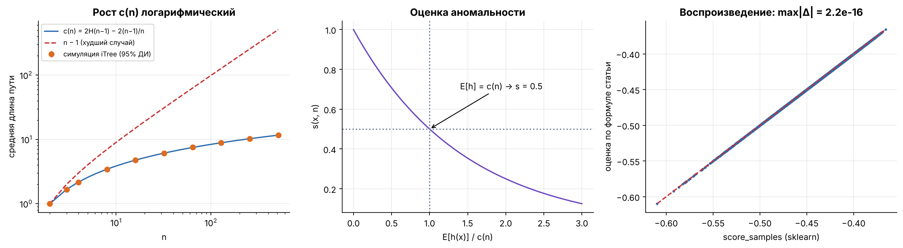
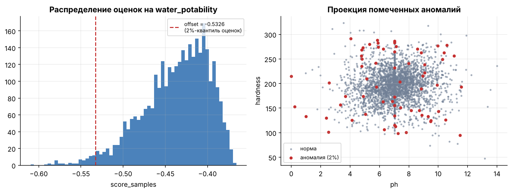
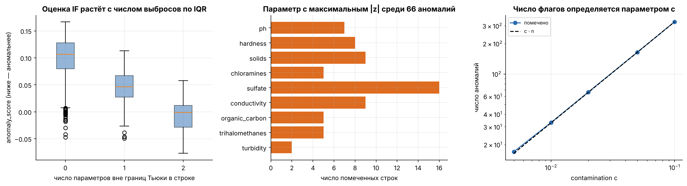

# 4. Isolation Forest

## 4.1 Постановка

Базовая модель обнаружения аномалий в проекте — Isolation Forest (IF), реализованный в `sklearn.ensemble.IsolationForest` и обёрнутый в `backend/ml/model.py::AnomalyDetector` и `backend/ml/anomaly_detection.py::detect_anomalies`. Параметры по умолчанию: $T=200$ деревьев, `contamination` $c=0.02$, подвыборка `max_samples='auto'` $=\min(256,n)$, пропуски заполняются медианой.

Идея метода: аномальное наблюдение отличается от остальных, поэтому его легко **изолировать** случайными разбиениями, и путь до листа в случайном дереве у него короткий. Ниже выводятся формулы оценки аномальности, доказывается нормирующая константа $c(n)$, проверяется, что формулы совпадают с реализацией sklearn с точностью до машинной погрешности, и разбирается механизм порога по `contamination`.

## 4.2 Определения

**Изолирующее дерево (iTree).** Дано множество $X'$ из $\psi$ точек в $\mathbb R^m$. Узел с множеством $S$ ($|S|>1$) разбивается так: равновероятно выбирается координата $q\in\{1,\dots,m\}$, затем $\theta\sim\mathrm{U}(\min_{S}x_q,\ \max_{S}x_q)$, и $S$ делится на $\{x_q<\theta\}$ и $\{x_q\ge\theta\}$. Рекурсия продолжается до $|S|\le1$ либо до глубины $l_{\max}=\lceil\log_2\psi\rceil$ ($=8$ при $\psi=256$).

**Длина пути.** $h(x)$ — число рёбер от корня до листа, в который попадает $x$. Если лист содержит $n_\ell>1$ точек (дерево остановлено по глубине), к глубине прибавляется поправка $c(n_\ell)$ — ожидаемая глубина недостроенного поддерева.

**Лес.** $T$ деревьев строятся по независимым подвыборкам размера $\psi$; для точки $x$ берётся среднее $\mathbb E[h(x)]=\frac1T\sum_{t=1}^{T}h_t(x)$.

## 4.3 Нормирующая константа $c(n)$

**Теорема 4.1.** Пусть $X'$ — $n\ge2$ независимых одинаково распределённых точек из непрерывного распределения на отрезке (одномерный случай), и изолирующее дерево строится без ограничения глубины. Тогда средняя длина пути до листа

$$
L_n=\mathbb E\,h(x)=2H_n-2=2H_{n-1}-\frac{2(n-1)}{n}=:c(n),
$$

где $H_k=\sum_{j=1}^{k}1/j$. При $n\to\infty$

$$
c(n)=2\ln n+2(\gamma-1)+\frac1n+O(n^{-2}).
$$

*Доказательство.*

*Шаг 1 (равномерность размера левой части).* Пусть $x_{(1)}<\dots<x_{(n)}$ — упорядоченные точки, $S_j=x_{(j+1)}-x_{(j)}$ ($j=1,\dots,n-1$) — внутренние промежутки. Для i.i.d. непрерывных точек из равномерного закона промежутки (вместе с краевыми) подчиняются симметричному распределению Дирихле, значит вектор $(S_1,\dots,S_{n-1})$ обменяем. Точка разбиения $\theta\sim\mathrm U(x_{(1)},x_{(n)})$ попадает в промежуток $j$ с вероятностью $S_j/\sum_iS_i$, и тогда в левую часть уходят ровно $k=j$ точек. По обменяемости $\mathbb P(k=j)=\mathbb E[S_j/\sum_iS_i]=\frac1{n-1}$, то есть $k$ равномерно на $\{1,\dots,n-1\}$. Условно на $k$ каждая из частей — снова i.i.d. равномерная выборка на своём отрезке, и рассуждение повторяется рекурсивно.

*Шаг 2 (рекуррентность).* Выбранная точка $x$ уходит влево с вероятностью $k/n$ и тогда её дальнейший путь имеет среднюю длину $L_k$; вправо — с вероятностью $(n-k)/n$ и длиной $L_{n-k}$. Поэтому

$$
L_n=1+\frac1{n-1}\sum_{k=1}^{n-1}\Bigl[\frac kn L_k+\frac{n-k}{n}L_{n-k}\Bigr]=1+\frac{2}{n(n-1)}\sum_{k=1}^{n-1}kL_k,\qquad L_1=0 .
$$

(вторая сумма равна первой заменой $k\to n-k$).

*Шаг 3 (решение).* Умножим на $n(n-1)$: $n(n-1)(L_n-1)=2\sum_{k=1}^{n-1}kL_k$. Запишем то же для $n+1$ и вычтем:

$$
(n+1)n(L_{n+1}-1)-n(n-1)(L_n-1)=2nL_n .
$$

Раскрывая скобки и приводя подобные: $(n+1)nL_{n+1}=2n+n(n+1)L_n$, откуда

$$
L_{n+1}=L_n+\frac{2}{n+1},\qquad n\ge2 .
$$

Из $L_2=1$ (при $n=2$ единственное разбиение изолирует обе точки за один шаг) получаем $L_n=1+2\sum_{j=3}^{n}\frac1j=2H_n-2$. Эквивалентная запись через $H_{n-1}$: $2H_n-2=2H_{n-1}+\frac2n-2=2H_{n-1}-\frac{2(n-1)}{n}$.

*Шаг 4 (асимптотика).* $H_n=\ln n+\gamma+\frac1{2n}+O(n^{-2})$, поэтому $2H_n-2=2\ln n+2\gamma-2+\frac1n+O(n^{-2})$. $\square$

**Замечание о применимости.** Теорема точна для i.i.d. равномерных данных в одном измерении. Для произвольного распределения значение $c(n)$ — нормирующий масштаб (такой же, как у неудачного поиска в случайном двоичном дереве поиска), а не точное математическое ожидание. Для сравнения: в худшем случае (каждое разбиение отделяет одну точку) глубина равна $n-1$.

### Проверка симуляцией

Скрипт `s03_isolation_forest.py` строит настоящие iTree на $n$ i.i.d. равномерных точках (400 повторов на каждый $n$) и усредняет глубину листьев:

| $n$ | симуляция ± SE | $c(n)=2H_n-2$ | $2\ln n+2\gamma-2+1/n$ |
|---|---|---|---|
| 2 | 1.000 ± 0.000 | 1.000 | — |
| 4 | 2.166 ± 0.006 | 2.167 | — |
| 8 | 3.436 ± 0.014 | 3.436 | — |
| 16 | 4.790 ± 0.022 | 4.761 | — |
| 32 | 6.119 ± 0.026 | 6.117 | — |
| 64 | 7.509 ± 0.029 | 7.488 | — |
| 128 | 8.858 ± 0.030 | 8.866 | — |
| 256 | 10.208 ± 0.032 | 10.249 | 10.248 |
| 512 | 11.588 ± 0.031 | 11.633 | 11.632 |

Во всех точках расхождение укладывается в $\le2$ стандартные ошибки (максимальное $-0.045$ при $n=512$, $1.4\,\mathrm{SE}$); значения совпадают с $2H_n-2$, а не с «худшим случаем» $n-1$. Полный набор в `results/03_isolation_forest.json`.

*Замечание про sklearn.* В `sklearn.ensemble._iforest._average_path_length` используется асимптотическая форма $\tilde c(n)=2(\ln(n-1)+\gamma)-\frac{2(n-1)}n$ для $n\ge3$ (точные значения $0$ и $1$ при $n\le1$ и $n=2$). Она отличается от точной на $\approx1/(n-1)$ ($0.0039$ при $n=256$: $\tilde c(256)=10.2448$ против $10.2487$) и больше при малых $n$ ($\tilde c(3)=1.207$ против $1.667$). Это влияет только на поправку листьев и нормировку, на ранжирование точек практически не влияет.

*Рис. 4.1. Слева: $c(n)$ растёт логарифмически, худший случай — линейно; точки — симуляция iTree. В середине: оценка $s=2^{-E[h]/c(n)}$ как функция $E[h]/c(n)$. Справа: ручной расчёт по формуле статьи против `score_samples` sklearn на реальных данных, максимальное расхождение $2.2\cdot10^{-16}$.*

## 4.4 Оценка аномальности

**Определение.**

$$
s(x,n)=2^{-\mathbb E[h(x)]/c(n)} .
$$

**Утверждение 4.2 (свойства $s$).**

1. $s\in(0,1]$ и $s$ строго убывает по $\mathbb E[h]$.
2. $\mathbb E[h]\to0\ \Rightarrow\ s\to1$ (точка изолируется сразу, максимально аномальна).
3. $\mathbb E[h(x)]=c(n)\ \Rightarrow\ s=\tfrac12$ (средняя точка).
4. $\mathbb E[h]\to n-1\ \Rightarrow\ s\to2^{-(n-1)/c(n)}\to0$ при $n\to\infty$ (точка глубоко внутри плотной области).

*Доказательство.* Функция $u\mapsto2^{-u}$ положительна, убывает, равна $1$ при $u=0$ и $\tfrac12$ при $u=1$. Подстановка $u=\mathbb E[h]/c(n)\ge0$ даёт пп. 1–3. Для п. 4 $u=(n-1)/c(n)\to\infty$, так как $c(n)=O(\ln n)$. $\square$

**Следствие (интерпретация).** Если для всех точек $s\approx0.5$, то в выборке нет явно выделяющихся наблюдений. Если у некоторых $s$ заметно выше, чем у остальных — это кандидаты в аномалии; сама по себе $s$ вероятностью аномальности не является.

**Соглашение sklearn.** `score_samples` возвращает $-s\in[-1,0)$, поэтому **чем ниже, тем аномальнее**. В проекте `anomaly_score = decision_function`, то есть `score_samples` минус сдвиг `offset_`; отрицательные значения соответствуют аномалиям.

## 4.5 Порог по `contamination`

В sklearn при `contamination` $=c\in(0,0.5]$ сдвиг определяется как эмпирический $c$-квантиль оценок на обучающих данных:

$$
\text{offset}=Q_c\bigl(\{\text{score\_samples}(x_i)\}_{i=1}^n\bigr),\qquad
\hat y_i=\mathbf 1\bigl[\text{score\_samples}(x_i)<\text{offset}\bigr].
$$

**Утверждение 4.3.** На обучающей выборке помечается около $cn$ точек, **независимо от того, есть ли в данных аномалии**.

*Доказательство.* По определению квантиля доля оценок строго ниже $Q_c$ не превосходит $c$ и отличается от $c$ не более чем на $1/n$ (при отсутствии совпадений). $\square$

Это принципиальное свойство метода при заданной `contamination`: IF по построению пометит долю $c$ данных, а не обнаружит «настоящее» число аномалий. Если истинная доля аномалий $\pi\ne c$, при $c>\pi$ растёт число ложных срабатываний, при $c<\pi$ часть аномалий не пометится (раздел 6, п. 6.6, проверяет это численно).

**Проверка на реальных данных** (`water_potability`, $n=3\,276$, 9 параметров, $c=0.02$, пропуски → медиана):

- offset $=-0.532600$ совпадает с 2 %-квантилем `score_samples` (равенство до последнего знака);
- помечено $66$ строк $=2.015\%$ при $cn=65.52$ (округление вверх);
- подвыборка $\psi=256$ (7.8 % данных на дерево), $c(256)=10.249$.

| $c$ | помечено строк | $c\cdot n$ |
|---|---|---|
| 0.005 | 17 | 16.4 |
| 0.01 | 33 | 32.8 |
| 0.02 | 66 | 65.5 |
| 0.05 | 164 | 163.8 |
| 0.1 | 328 | 327.6 |

Число помеченных строк определяется параметром $c$, а не данными, как и утверждает 4.3.

### Воспроизведение расчёта sklearn

Скрипт вычисляет оценку независимо — по формуле $s=2^{-\bar h/c(\psi)}$, где $\bar h=\frac1T\sum_t\bigl[(\text{глубина узла}-1)+\tilde c(n_{\ell,t})\bigr]$ берётся из внутренних деревьев обученной модели, — и сравнивает с `score_samples`. Максимальное абсолютное расхождение на 3 276 точках: $2.2\cdot10^{-16}$. Значит реализация действительно вычисляет оценку из раздела 4.4, а константа нормировки равна $\tilde c(\psi)$.

## 4.6 Свойства метода

**Сложность.** Обучение $O(T\,\psi\log\psi)$, оценка $O(T\,n\log\psi)$; память не зависит от $n$ (дерево строится на $\psi$ точках). Для $T=200$, $\psi=256$ время на $n=20\,000$ строк $\approx0.4$ с (раздел 5).

**Инвариантность к масштабу.** Пусть $x\mapsto Ax+b$ — покоординатное аффинное преобразование с $A=\mathrm{diag}(a_1,\dots,a_m)$, $a_q>0$. Разбиение $\theta\sim\mathrm U(\min,\max)$ переходит в $a_q\theta+b_q\sim\mathrm U(a_q\min+b_q,\ a_q\max+b_q)$, и условия $x_q<\theta$ сохраняются, поэтому при тех же случайных числах дерево топологически то же самое, а значит $h(x)$ и $s$ не меняются. **Следствие:** IF не требует стандартизации признаков (в отличие от метода ближайших соседей, раздел 5). Преобразования, не являющиеся покоординатно монотонными аффинными (например, логарифм), меняют равномерность разбиений и оценки.

**Подвыборка.** Малое $\psi$ уменьшает эффекты маскировки (masking, когда близкие аномалии прячут друг друга) и затопления (swamping, когда нормальные точки рядом с аномалиями признаются аномальными); при $\psi=256$ эффект уже стабилен.

## 4.7 Расчёт на реальных данных: что именно помечено

*Рис. 4.2. Слева: распределение `score_samples` и порог (offset $=-0.5326$). Справа: проекция помеченных аномалий на плоскость pH–hardness.*

Скрипт `s07_real_data.py`:

| Показатель | Значение |
|---|---|
| помечено IF ($c=0.02$) | 66 строк |
| строк с выбросом по Тьюки (хотя бы один параметр) | 325 |
| строк с $\lvert z\rvert>3$ (хотя бы один параметр) | 115 |
| пересечение IF и Тьюки | 48 (индекс Жаккара 0.14) |
| пересечение IF и $\lvert z\rvert>3$ | 25 (индекс Жаккара 0.16) |
| среднее число нарушенных параметров Тьюки: помеченные IF / остальные | 1.08 / 0.09 |
| доля помеченных: строки с пропусками / без пропусков | 1.4 % (18 из 1 265) / 2.4 % (48 из 2 011) |
| устойчивость к seed (Жаккар по 10 seed), среднее / min / max | 0.60 / 0.53 / 0.65 |

Интерпретация:

1. **IF согласуется с одномерными методами**, но не дублирует их: помеченные IF строки нарушают в среднем $1.08$ границы Тьюки (против $0.09$ у остальных), но IF выбирает лишь 66 из 325 «одномерных» кандидатов, отдавая предпочтение строкам с сильным отклонением по одному или нескольким параметрам одновременно.
2. **Пропуски, по-видимому, занижают долю помеченных.** Доля флагов в строках с пропусками $1.4\%$ против $2.4\%$ в строках без пропусков: медианная подстановка делает такие строки «более обычными» (раздел 1, п. 1.6). Разница лежит на границе значимости ($\chi^2$ по таблице $2\times2$: $\chi^2=3.66$, $p=0.056$; точный критерий Фишера: $p=0.056$, отношение шансов $0.59$), поэтому это предварительное наблюдение, а не доказанный эффект; но направление совпадает с механизмом медианной подстановки, и при высокой доле пропусков (`sulfate` 24 %) их стоит учитывать явно.
3. **Набор помеченных строк неустойчив к seed** (Жаккар $0.60$). Для данных без выраженных аномалий это ожидаемо: точки около порога имеют почти одинаковые оценки, и случайность построения деревьев меняет, какие из них окажутся ниже $Q_c$. Усреднение по $T=200$ деревьев уменьшает разброс, но не устраняет его. Практический вывод: для итогового отчёта фиксируйте `random_state` (в проекте $42$) и указывайте порог не как «аномалии есть/нет», а как «топ-$c$ % по оценке».
4. **Параметры, которые чаще всего вносят максимальный вклад** среди 66 помеченных: `sulfate` (16), `conductivity` (9), `solids` (9), `hardness` (8), `ph` (7).

*Рис. 4.3. Слева: оценка IF по числу параметров вне границ Тьюки в строке. В середине: параметр с максимальным $\lvert z\rvert$ среди 66 помеченных строк. Справа: число помеченных строк как функция `contamination`.*

## 4.8 Вывод для работы

1. $c(n)=2H_n-2$ выведена и подтверждена симуляцией настоящих iTree; оценка $s=2^{-E[h]/c(n)}$ в sklearn вычисляется именно так (расхождение $2\cdot10^{-16}$).
2. Число помеченных аномалий задаётся параметром `contamination`, а не данными (утверждение 4.3): интерпретировать флаги можно как «наиболее нетипичные $c$ % наблюдений».
3. IF не требует масштабирования признаков, но чувствителен к способу заполнения пропусков.

## 4.9 Ограничения

- Теорема 4.1 строго доказана для одномерного равномерного случая; для многомерных реальных данных $c(n)$ — нормировка, а не точное среднее.
- Метод не использует метки, поэтому его «точность» на реальных данных без разметки не определена; в разделе 5 качество оценивается на синтетических данных с известными аномалиями.
- При большом числе слабо информативных признаков (в ML-конвейере проекта к параметрам добавляются `hour`, `day_of_week`, `month`, `season` и скользящие признаки) случайный выбор координаты разбиения разбавляет полезные признаки: вероятность выбрать информативную координату равна доле таких координат в наборе.
