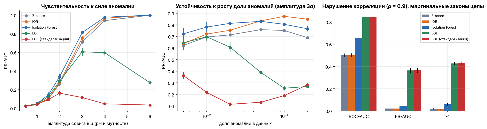
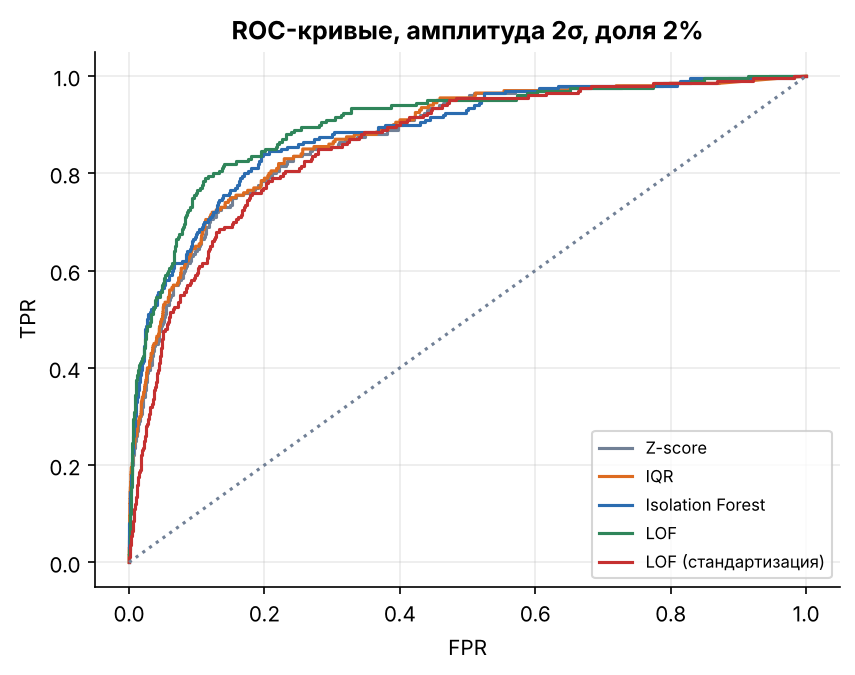
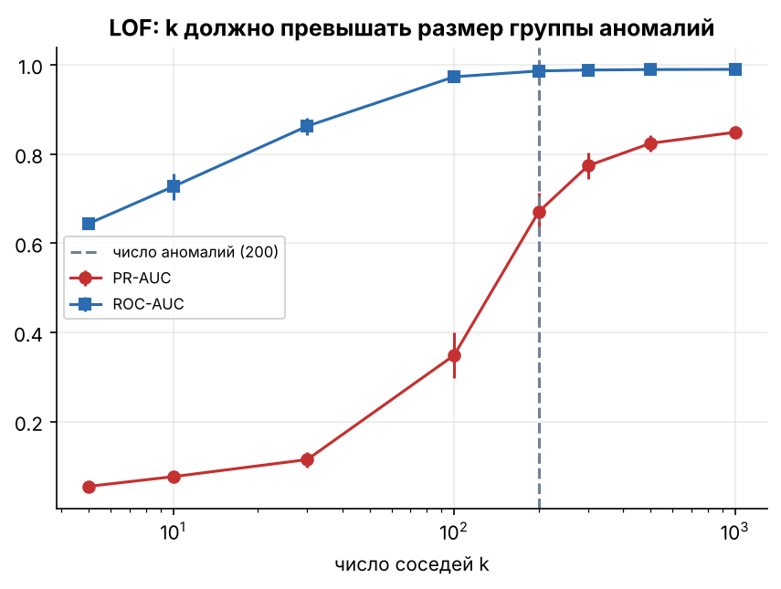

# 5. LOF и сравнение детекторов аномалий

## 5.1 Постановка

В `experiments/anomaly_comparison.py` сравниваются четыре метода: $Z$-оценка, правило Тьюки (IQR), Isolation Forest и Local Outlier Factor (LOF). Раздел даёт формальные определения оценок, доказывает, в каких случаях одномерные методы **принципиально** не способны найти аномалию, и по результатам расчётов выясняет, когда ошибаются многомерные методы. Все числа получены скриптом `s05_detector_comparison.py` (`results/05_detector_comparison.json`), в котором используются функции `zscore`, `iqr`, `iforest`, `lof`, `evaluate` из репозитория без изменений.

## 5.2 Определения оценок

Пусть $X\in\mathbb R^{n\times m}$. Каждый метод даёт числовую оценку $a_i$ (больше — аномальнее), порог по доле $\pi$ определён как $(1-\pi)$-квантиль оценок (`evaluate`).

**$Z$-оценка.**

$$
a_i^{Z}=\max_{j}\ \frac{|x_{ij}-\bar x_j|}{s_j} .
$$

**Расстояние Тьюки.** При $\mathrm{IQR}_j=Q_{3,j}-Q_{1,j}$ (вместо 0 подставляется $10^{-9}$)

$$
a_i^{\mathrm{IQR}}=\max_{j}\ \max\Bigl\{\frac{Q_{1,j}-x_{ij}}{\mathrm{IQR}_j},\ \frac{x_{ij}-Q_{3,j}}{\mathrm{IQR}_j},\ 0\Bigr\} .
$$

Значение $a^{\mathrm{IQR}}_i>1.5$ эквивалентно выходу за границы Тьюки.

**Isolation Forest.** $a_i^{\mathrm{IF}}=-\texttt{score\_samples}(x_i)=s(x_i,\psi)$ (раздел 4).

**LOF** (Breunig, Kriegel, Ng, Sander, 2000). Пусть $d$ — евклидово расстояние, $k$ — число соседей (в коде $k=30$).

1. $k$-расстояние точки $A$: $d_k(A)$ — расстояние до её $k$-го ближайшего соседа; $N_k(A)$ — множество $k$ ближайших соседей.
2. Расстояние достижимости: $\operatorname{rd}_k(A,B)=\max\{d_k(B),\ d(A,B)\}$.
3. Локальная плотность достижимости:
$$
\operatorname{lrd}_k(A)=\Bigl(\frac1{|N_k(A)|}\sum_{B\in N_k(A)}\operatorname{rd}_k(A,B)\Bigr)^{-1}.
$$
4. Фактор локальной аномальности:
$$
\operatorname{LOF}_k(A)=\frac1{|N_k(A)|}\sum_{B\in N_k(A)}\frac{\operatorname{lrd}_k(B)}{\operatorname{lrd}_k(A)} .
$$

**Свойство нормировки.** Если точка находится в однородной области (плотность её соседей близка к её собственной), то $\operatorname{lrd}_k(B)\approx\operatorname{lrd}_k(A)$ и $\operatorname{LOF}\approx1$; для точки, существенно менее плотной, чем соседи, $\operatorname{LOF}\gg1$. Таким образом LOF сравнивает плотность точки с **локальной** плотностью окружения, а не с глобальной.

## 5.3 Теорема о слепоте одномерных методов к нарушению корреляции

Рассмотрим сценарий C: два признака $x_1,x_2$ с корреляцией $\rho=0.9$ в нормальном режиме и признак $x_3\sim\mathcal N(0,1)$ независимо. Нормальные данные: $x_2=\rho x_1+\sqrt{1-\rho^2}\,\varepsilon$. Аномалии: $x_2=-\rho x_1+\sqrt{1-\rho^2}\,\varepsilon$, то есть корреляция меняет знак, а **маргинальные законы** $x_1,x_2,x_3$ остаются $\mathcal N(0,1)$.

**Теорема 5.1.** Пусть оценка $a(x)$ — функция только от вектора абсолютных значений $(|x_1|,|x_2|,|x_3|)$ (это так для $a^{Z}$ при известных $\bar x_j=0$, $s_j=1$, и для $a^{\mathrm{IQR}}$, поскольку квартили симметричного закона симметричны относительно нуля). Тогда распределение $a$ у нормальных точек и у аномалий одинаково, и $\mathrm{ROC\text{-}AUC}=\tfrac12$.

*Доказательство.* Пусть $(x_1,x_2,x_3)$ — нормальная точка. Рассмотрим отображение $S(x_1,x_2,x_3)=(x_1,-x_2,x_3)$. Оно переводит нормальное распределение (корреляция $+\rho$) в распределение аномалии (корреляция $-\rho$): совместная нормальная плотность с корреляцией $+\rho$ при замене $x_2\to-x_2$ становится плотностью с корреляцией $-\rho$. При этом $|{-x_2}|=|x_2|$, поэтому вектор $(|x_1|,|x_2|,|x_3|)$ не меняется. Значит функция от этого вектора имеет у нормальных точек и у аномалий одно и то же распределение. Тогда $\mathbb P(a_{\text{ан}}>a_{\text{норм}})=\tfrac12$ (ничьи делятся пополам), а ROC-AUC — это именно эта вероятность (раздел 6, утверждение 6.2). $\square$

**Эксперимент** (10 000 строк, 2 % аномалий, 4 seed): $Z$-score и IQR дают ROC-AUC $0.501\pm0.016$ и $0.501\pm0.018$ — ровно $\tfrac12$, как предсказывает теорема. Isolation Forest улучшает результат до $0.656\pm0.015$, а LOF — до $0.847\pm0.013$ (PR-AUC $0.364$ против $0.021$ у $Z$-score). Многомерные методы видят нарушение совместной структуры, одномерные — нет.

## 5.4 Результаты сравнения

### Базовый сценарий репозитория

Данные `make_data`: $\mathrm{ph}\sim\mathcal N(7.2,0.15^2)$, $\mathrm{temperature}\sim\mathcal N(15,2^2)$, $\mathrm{turbidity}=|\mathcal N(1,0.3^2)|$; у 2 % строк pH смещён на $\pm\mathrm{U}(1;2.5)$ ($\approx7$–$17\sigma$), мутность — на $+\mathrm{U}(2;6)$ ($\approx7$–$20\sigma$). 10 000 строк, 4 seed:

| Метод | ROC-AUC | PR-AUC | F1 |
|---|---|---|---|
| Z-score | 1.000 ± 0.000 | 1.000 ± 0.000 | 0.994 ± 0.004 |
| IQR | 1.000 ± 0.000 | 1.000 ± 0.000 | 1.000 ± 0.000 |
| Isolation Forest | 1.000 ± 0.000 | 1.000 ± 0.000 | 1.000 ± 0.000 |
| LOF, $k=30$ | 0.539 ± 0.017 | 0.121 ± 0.013 | 0.129 ± 0.020 |
| LOF, $k=30$, стандартизация | 0.480 ± 0.028 | 0.021 ± 0.003 | 0.006 ± 0.004 |

Сдвиги в этом сценарии огромны (многие $\sigma$), поэтому три метода отделяют аномалии идеально и сравнение между ними **неинформативно**. Неожиданный результат — LOF практически не отличает аномалии от нормы (ROC-AUC 0.54 и даже 0.48 при стандартизации признаков). Первая гипотеза («проблема в масштабе температуры $\sigma=2$ против pH $\sigma=0.15$») **не подтвердилась**: стандартизация ничего не улучшила. Причина другая, см. 5.5.

### Зависимость от силы аномалии (доля 2 %, амплитуда в единицах $\sigma$ шума, 3 seed)

| Амплитуда | Z-score | IQR | IF | LOF, $k=30$ |
|---|---|---|---|---|
| 1 | 0.039 | 0.039 | 0.049 | 0.045 |
| 2 | 0.261 | 0.276 | 0.339 | 0.291 |
| 3 | 0.714 | 0.754 | 0.813 | 0.607 |
| 4 | 0.941 | 0.967 | 0.978 | 0.596 |
| 6 | 0.999 | 1.000 | 1.000 | 0.274 |

(PR-AUC; базовая линия случайного классификатора — доля аномалий $0.02$.) У всех методов PR-AUC растёт с амплитудой, и **IF лидирует при средних амплитудах** (2–4$\sigma$): при амплитуде 3 он даёт $0.813$ против $0.714$ у $Z$-score. Но у LOF при росте амплитуды PR-AUC **падает** ($0.607\to0.274$) — это та же аномалия поведения, что и в базовом сценарии.

### Зависимость от доли аномалий (амплитуда 3$\sigma$, 3 seed, PR-AUC)

| Доля | Z-score | IQR | IF | LOF, $k=30$ |
|---|---|---|---|---|
| 0.5 % | 0.623 | 0.639 | 0.723 | 0.646 |
| 2 % | 0.714 | 0.754 | 0.813 | 0.607 |
| 5 % | 0.759 | 0.835 | 0.830 | 0.389 |
| 10 % | 0.751 | 0.873 | 0.805 | 0.253 |
| 20 % | 0.690 | 0.849 | 0.766 | 0.268 |

При росте доли аномалий $Z$-оценка слабеет сильнее всех «глобальных» методов (среднее и $s$ загрязняются аномалиями, это эффект маскировки), IQR остаётся наиболее устойчивым ($0.85$ при 20 %), IF держится посередине. LOF с $k=30$ быстро деградирует.

*Рис. 5.1. Слева: PR-AUC от амплитуды сдвига. В середине: PR-AUC от доли аномалий (амплитуда 3σ). Справа: сценарий с нарушенной корреляцией ($\rho=0.9$) — одномерные методы на уровне случайного (ROC-AUC 0.5), LOF выигрывает.*

*Рис. 5.2. ROC-кривые при амплитуде 2σ, доле 2 %.*

## 5.5 Почему LOF ошибается в базовом сценарии

**Наблюдение 5.2.** LOF с числом соседей $k$ не обнаруживает группу аномалий, если размер группы больше $k$.

*Объяснение.* Пусть в данных есть группа $G$ из $g=|G|$ взаимно близких аномальных точек, расположенных далеко от основного облака. Если $g>k$, то все $k$ ближайших соседей точки из $G$ лежат в $G$. Поэтому $\operatorname{lrd}_k$ точки сравнивается с $\operatorname{lrd}_k$ других точек той же группы, и их отношение близко к 1: LOF их не выделяет, хотя они удалены от основной массы. В базовом сценарии аномалий $g=200$ при $k=30$, и они к тому же рассеяны по большой области (сдвиги pH $\pm$ до 17$\sigma$, мутности до 20$\sigma$), так что соседи аномалии — другие аномалии с такой же низкой плотностью.

**Проверка прямым экспериментом** (ключевой параметр — $k$; стандартизованные данные, 10 000 строк, 200 аномалий амплитуды 3$\sigma$, 3 seed):

| $k$ | ROC-AUC | PR-AUC | F1 |
|---|---|---|---|
| 5 | 0.644 ± 0.003 | 0.055 ± 0.002 | 0.123 ± 0.008 |
| 10 | 0.727 ± 0.030 | 0.076 ± 0.009 | 0.133 ± 0.021 |
| 30 | 0.862 ± 0.019 | 0.115 ± 0.018 | 0.145 ± 0.019 |
| 100 | 0.973 ± 0.003 | 0.349 ± 0.051 | 0.348 ± 0.049 |
| 200 | 0.986 ± 0.003 | 0.670 ± 0.043 | 0.647 ± 0.029 |
| 300 | 0.988 ± 0.003 | 0.774 ± 0.029 | 0.712 ± 0.024 |
| 500 | 0.989 ± 0.003 | 0.824 ± 0.018 | 0.757 ± 0.010 |
| 1000 | 0.990 ± 0.003 | 0.849 ± 0.013 | 0.775 ± 0.012 |

PR-AUC растёт на порядок по мере того, как $k$ проходит значение $g=200$: $0.115$ при $k=30$, $0.670$ при $k=200$, $0.849$ при $k=1000$. Это подтверждает объяснение: **$k$ следует выбирать не меньше ожидаемого размера группы аномалий**. Утверждение остаётся эмпирическим наблюдением на синтетических данных, строгого доказательства порога $k\approx g$ здесь не приводится.

*Рис. 5.3. Качество LOF как функция $k$; вертикальная линия — число аномалий ($g=200$).*

## 5.6 Масштаб и инвариантность

| Свойство | Z-score | IQR | Isolation Forest | LOF |
|---|---|---|---|---|
| Покоординатное аффинное преобразование | инвариантен | инвариантен | инвариантен (разд. 4.6) | **не инвариантен** (евклидово расстояние) |
| Выбор порога | квантиль оценок | квантиль оценок | квантиль оценок (`contamination`) | квантиль оценок |
| Учитывает корреляции признаков | нет (теорема 5.1) | нет | частично | да (через локальную плотность) |
| Устойчивость к загрязнению среднего/разброса | нет | да (медиана, квартили) | да (подвыборка) | зависит от $k$ |

Инвариантность $Z$ и IQR следует из того, что они стандартизуют каждый признак своей оценкой масштаба; LOF использует евклидово расстояние, и признак с большим разбросом доминирует. В базовом сценарии это не оказалось главным фактором (стандартизация не помогла), но в общем случае стандартизация признаков перед LOF — необходимая мера предосторожности.

## 5.7 Время работы

Однократный запуск, 3 признака, Python/sklearn на машине сессии:

| $n$ | Z-score | IQR | IF (200 деревьев) | LOF ($k=30$) |
|---|---|---|---|---|
| 5 000 | 0.002 с | 0.004 с | 0.25 с | 0.035 с |
| 20 000 | 0.003 с | 0.007 с | 0.43 с | 0.16 с |

$Z$ и IQR линейны по $n$ ($O(nm)$ плюс сортировка для квартилей), IF — $O(T\,n\log\psi)$ при фиксированном $\psi$, LOF — $O(n\log n)$ при использовании kd-дерева в низких размерностях и $O(n^2)$ в худшем случае. Абсолютные значения зависят от оборудования и меняются между запусками на 5–15 %; соотношения стабильны.

## 5.8 Вывод для работы

1. **Одномерные методы** ($Z$, IQR) надёжны, быстры и интерпретируемы, но принципиально слепы к нарушению совместной структуры признаков (теорема 5.1, ROC-AUC $=0.5$ в эксперименте).
2. **Isolation Forest** — универсальный компромисс: лучший или близкий к лучшему при средней силе аномалий (PR-AUC 0.813 против 0.714 у $Z$-score при амплитуде 3$\sigma$), инвариантен к масштабу, устойчив к росту доли аномалий лучше $Z$-оценки.
3. **LOF** выигрывает на структурных аномалиях, но чувствителен к $k$ относительно размера группы аномалий: при $k<g$ он может провалиться даже на очень сильных сдвигах (PR-AUC $0.115$ при $k=30$ и $0.849$ при $k=1000$ на тех же данных).
4. Ни один метод не доминирует во всех сценариях, поэтому для системы мониторинга разумно использовать IF как основной детектор, а $Z$/IQR — как быстрый одномерный контроль по каждому параметру.

## 5.9 Ограничения

- Все выводы получены на синтетических данных с известной структурой аномалий (независимые нормальные признаки, сдвиг среднего или смена знака корреляции); реальные аномалии воды (контаминация, отказ датчика, сезонные эффекты) устроены сложнее.
- Базовый сценарий репозитория насыщен (метрики $=1.0$), поэтому сравнивать методы в нём нельзя; информативны сценарии со средней амплитудой и нарушением корреляции, добавленные в этом разделе.
- Порог по известной доле $\pi$ (в `evaluate`) — оптимистичное допущение: в эксплуатации доля аномалий неизвестна (раздел 4, утверждение 4.3).
- В `experiments/anomaly_comparison.py` значение $k=30$ зашито в функции `lof`; для сопоставимости с другими долями аномалий его стоит сделать параметром.
