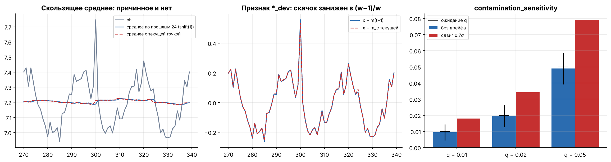

# 6. Признаки, валидация и метрики качества

## 6.1 Постановка

ML-конвейер (`backend/ml/features.py`, `training.py`, `evaluation.py`) строит признаки по времени и скользящему окну, делит данные по времени на обучающую и тестовую части и оценивает модель без меток (распределение оценок, доля аномалий) либо с метками (precision, recall, F1, ROC-AUC, PR-AUC). Раздел формализует признаки, доказывает их причинность, выводит свойства метрик и проверяет их численно (`s06_validation_features.py`).

## 6.2 Признаки

Для параметра $x$ и станции $g$ значения упорядочены по времени: $x_1,x_2,\dots$ Окно $w$ (`rolling_window` $=24$), минимум наблюдений $\mu$ (`min_periods` $=3$). Признаки на момент $t$:

$$
m_t=\frac1{|W_t|}\sum_{u\in W_t}x_u,\qquad
v_t=\sqrt{\frac1{|W_t|-1}\sum_{u\in W_t}(x_u-m_t)^2},\qquad
\mathrm{dev}_t=x_t-m_t,
$$

где окно строится **по сдвинутому ряду**: $W_t=\{t-w,\dots,t-1\}$ (`shift(1)` до скользящих агрегатов); $m_t,v_t$ не определены (NaN), если $|W_t|<\mu$. Дополнительно: час, день недели, месяц, сезон $\{0,1,2,3\}$ и $\Delta_t=t-t_{\text{prev}}$ (секунды до предыдущего измерения станции).

### Причинность признаков

**Теорема 6.1.** При $W_t=\{t-w,\dots,t-1\}$ признаки $m_t$ и $v_t$ зависят только от $x_{t-w},\dots,x_{t-1}$, а $\mathrm{dev}_t$ — от $x_t$ и этих же значений. В частности, они не зависят от будущих значений $x_u$, $u>t$, и $m_t,v_t$ не зависят от самого $x_t$.

*Доказательство.* Прямо из определения: суммы берутся по $u\in W_t\subset\{1,\dots,t-1\}$; $x_t$ входит только в разность $\mathrm{dev}_t=x_t-m_t$. $\square$

**Эксперимент (проверка на коде проекта).** К ряду из 600 точек применяется `build_features`, затем все значения $\mathrm{ph}$ начиная с $t_0=300$ сдвигаются на $+5$, и признаки пересчитываются:

| Что сравнивается | Максимальное изменение |
|---|---|
| `ph_roll_mean`, `ph_roll_std`, `ph_dev` в строках $t<t_0$ | $0$ |
| `ph_roll_mean`, `ph_roll_std` в строке $t_0$ | $0$ |
| `ph_dev` в строке $t_0$ | $5.0$ (содержит $x_{t_0}$, так и должно быть) |
| `ph_roll_mean` в строках $t_0+1,\dots,t_0+24$ | $5.0$ (это прошлое для будущих строк) |

Признаки до момента $t_0$ не изменились, а скользящее среднее в самой точке $t_0$ не зависит от её значения — **причинность подтверждена**.

**Что произошло бы без `shift(1)`.** Если окно включает текущую точку ($W'_t=\{t-w+1,\dots,t\}$), то

$$
x_t-m'_t=\frac{w-1}{w}\Bigl(x_t-\bar x_{W'_t\setminus\{t\}}\Bigr),
$$

то есть $\mathrm{dev}_t$ занижен в $(w-1)/w$ раз (для $w=24$ это $0.9583$), потому что точка «тянет» среднее к себе. Численная проверка: отношение $x_t-m'_t$ к $x_t-\bar x_{\text{23 предыдущих}}$ равно $0.95833$ с точностью до $10^{-12}$ (минимум $0.958333333333$, максимум $0.958333333334$). Для одиночного скачка потеря малая, и на синтетических сериях ROC-AUC по $|z|$ с окном без сдвига $0.979$ против $0.976$ с `shift(1)` — **практически одинаково**. То есть `shift(1)` нужен не ради точности, а ради корректности: признак строится только из доступной в момент $t$ информации (онлайн-оценка совпадает с офлайн-оценкой), и, главное, исключается утечка в обучении с метками, где окно с текущей точкой «подглядывает» в значение, на котором потом учится модель. Утечка из **будущего** (центрированное окно $\{t-w/2,\dots,t+w/2\}$) уже не безобидна и привела бы к завышению качества на тесте.

## 6.3 Временное разбиение

`temporal_split(frame, ts, f)` сортирует строки по времени (`kind="stable"`), берёт границу $\tau=ts_{(\max(\lfloor fN\rfloor-1,0))}$ (элемент с индексом $\lfloor fN\rfloor-1$ в упорядоченном ряду) и формирует

$$
\text{train}=\{i:\ ts_i\le\tau\},\qquad \text{test}=\{i:\ ts_i>\tau\}.
$$

**Утверждение 6.1.** (а) Обучающая часть целиком предшествует тестовой: $\max_{\text{train}}ts\le\tau<\min_{\text{test}}ts$. (б) Доля обучающей части не меньше $f$, причём равенство возможно только при отсутствии совпадающих временных меток на границе.

*Доказательство.* (а) следует из определения. (б) В упорядоченном ряду из $N$ элементов в train попадают все элементы вплоть до *последнего* элемента со значением $\tau$, то есть не менее $\lfloor fN\rfloor$ элементов. $\square$

**Пример** (`split_example`, 10 измерений с метками 4+4+2 по датам, $f=0.7$): граница — вторая дата, в train попадают 8 строк, в test 2, то есть фактическая доля $0.8>0.7$ из-за совпадающих меток.

Эта схема исключает утечку «будущего в прошлое» (в отличие от случайного разбиения, где соседние по времени, сильно коррелированные измерения попадают и в train, и в test).

## 6.4 Метрики с метками

Пусть $y_i\in\{0,1\}$ — метка аномалии, $a_i$ — оценка (больше — аномальнее), $\hat y_i$ — флаг после порога, $P_+$, $P_-$ — числа положительных и отрицательных примеров, $TP,FP,FN$ — стандартные счётчики.

$$
\mathrm{Precision}=\frac{TP}{TP+FP},\quad
\mathrm{Recall}=\frac{TP}{TP+FN},\quad
F_1=\frac{2\,TP}{2\,TP+FP+FN} .
$$

**Утверждение 6.2 (вероятностный смысл ROC-AUC).**

$$
\mathrm{ROC\text{-}AUC}=\mathbb P(a_+>a_-)+\tfrac12\,\mathbb P(a_+=a_-)=\frac{U}{P_+P_-},
$$

где $a_+,a_-$ — оценки случайно выбранных положительного и отрицательного примеров, а $U$ — статистика Манна–Уитни.

*Доказательство (схема).* ROC-кривая — график $(\mathrm{FPR}(\theta),\mathrm{TPR}(\theta))$ по порогу $\theta$. Площадь под ней $\int\mathrm{TPR}\,d\mathrm{FPR}=\int\mathbb P(a_+>\theta)\,f_{a_-}(\theta)\,d\theta=\mathbb P(a_+>a_-)$ (для непрерывных оценок); при совпадении оценок трапециевидное интегрирование даёт вклад $\tfrac12$ за каждую ничью. Пары $(i,j)$ с $y_i=1$, $y_j=0$, в которых $a_i>a_j$, и составляют $U$. $\square$

**Численная проверка** (случайные оценки $\mathcal N(1,1)$ против $\mathcal N(0,1)$):

| $P_+$ | $P_-$ | `roc_auc_score` | доля пар | $U/(P_+P_-)$ |
|---|---|---|---|---|
| 50 | 950 | 0.79979 | 0.79979 | 0.79979 |
| 200 | 800 | 0.76957 | 0.76957 | 0.76957 |
| 500 | 500 | 0.74898 | 0.74898 | 0.74898 |

Три способа дают одно и то же число до последнего знака.

**Следствие для теоремы 5.1.** Если распределения оценок нормальных и аномальных точек совпадают, то $\mathrm{ROC\text{-}AUC}=\tfrac12$; именно это наблюдалось для $Z$-оценки и IQR в сценарии с нарушением корреляции.

**Утверждение 6.3 (совпадение precision, recall и $F_1$).** Если число помеченных точек равно числу положительных ($TP+FP=P_+$), то $\mathrm{Precision}=\mathrm{Recall}=F_1$.

*Доказательство.* $TP+FP=P_+=TP+FN\Rightarrow FP=FN$. Тогда $\mathrm{Precision}=TP/(TP+FP)=TP/P_+=\mathrm{Recall}$, а $F_1$ — среднее гармоническое двух равных чисел равно им же. $\square$

Это относится к функции `evaluate` из экспериментов: порог выбирается как $(1-\pi)$-квантиль оценок, то есть помечается доля $\pi$ данных, равная истинной доле аномалий. Поэтому в таблицах раздела 5 precision, recall и $F_1$ совпадают — и сообщать нужно один из них. Численная проверка на 20 000 точек:

| Доля аномалий | Precision | Recall | $F_1$ | PR-AUC |
|---|---|---|---|---|
| 1 % | 0.3150 | 0.3150 | 0.3150 | 0.2614 |
| 2 % | 0.3775 | 0.3775 | 0.3775 | 0.3725 |
| 5 % | 0.5210 | 0.5210 | 0.5210 | 0.5354 |
| 10 % | 0.6085 | 0.6085 | 0.6085 | 0.6585 |

**PR-AUC** (`average_precision_score`) $=\sum_k(R_k-R_{k-1})P_k$ — средняя точность по порогам; для случайного классификатора она равна доле положительных $\pi$, поэтому интерпретировать её нужно относительно $\pi$ (например, $0.037$ при $\pi=0.02$ — это лучше случайного в 1.9 раза, а $0.813$ (IF при амплитуде $3\sigma$, раздел 5) — в 41 раз).

## 6.5 Метрики без меток

`unsupervised_report` для обучающей и тестовой частей считает долю аномалий $\hat\pi_{\text{train}},\hat\pi_{\text{test}}$, квантили оценок $\{0.01,0.05,0.5,0.95\}$, сдвиг $\Delta\pi=\hat\pi_{\text{test}}-\hat\pi_{\text{train}}$ и `contamination_sensitivity`

$$
\mathrm{CS}(q)=\frac1{N_{\text{test}}}\sum_{i\in\text{test}}\mathbf 1\bigl[a_i^{\text{ниже}}\le Q_q(\text{оценок train})\bigr],\qquad q\in\{0.01,0.02,0.05\}.
$$

**Утверждение 6.4.** Если тестовые данные распределены так же, как обучающие, то $\mathbb E[\mathrm{CS}(q)]\approx q$, а $\mathrm{SD}[\mathrm{CS}(q)]\approx\sqrt{q(1-q)/N_{\text{test}}}$ (биномиальный закон с неслучайной границей — приближение).

*Доказательство (схема).* Граница $Q_q$ — квантиль распределения оценок; при отсутствии дрейфа каждая тестовая точка опускается ниже неё с вероятностью $q$, независимо. Число таких точек биномиально $\mathrm{Bin}(N_{\text{test}},q)$. Дополнительная дисперсия появляется из-за того, что $Q_q$ оценивается по конечной обучающей выборке. $\square$

**Эксперимент** (60 повторов; обучение на 6 000 точек $\mathcal N(0,I_3)$, IF с 100 деревьями; тест 2 000 точек):

| $q$ | CS без дрейфа, среднее | SD по повторам | биномиальное SD | CS при сдвиге $+0.7\sigma$ по первому признаку |
|---|---|---|---|---|
| 0.01 | 0.0095 | 0.0025 | 0.0022 | 0.0180 |
| 0.02 | 0.0196 | 0.0035 | 0.0031 | 0.0343 |
| 0.05 | 0.0490 | 0.0050 | 0.0049 | 0.0790 |

Без дрейфа $\mathrm{CS}(q)\approx q$ (с отклонением не более $6\%$ отн.), разброс чуть выше биномиального (на 2–14 %) из-за оценки границы по конечной выборке; при сдвиге на $0.7\sigma$ значение растёт в $1.6$–$1.8$ раза. Следовательно, отклонение $\mathrm{CS}(q)$ от $q$ на много биномиальных SD — признак дрейфа распределения (дополнение к PSI, раздел 7).

*Рис. 6.1. Слева: скользящее среднее по прошлому окну и по окну с текущей точкой вокруг скачка. В середине: $\mathrm{dev}_t$ для двух вариантов (скачок занижен в $23/24$). Справа: `contamination_sensitivity` без дрейфа (≈ $q$, интервал $\pm1.96\,\mathrm{SD}$) и при сдвиге $0.7\sigma$.*

## 6.6 Выбор `contamination` и ошибка по доле аномалий

Из утверждений 4.3 и 6.3 вытекает простая оценка. Пусть истинная доля аномалий $\pi$, а модель помечает долю $c$ точек с лучшими оценками (идеальное ранжирование: все аномалии выше всех нормальных точек). Тогда

$$
\mathrm{Precision}=\min\Bigl(1,\frac{\pi}{c}\Bigr),\qquad \mathrm{Recall}=\min\Bigl(1,\frac{c}{\pi}\Bigr),
$$

и $F_1=2\min(\pi,c)/(\pi+c)$ максимален ($=1$) только при $c=\pi$. При $c=0.02$ и $\pi=0.05$ даже **идеальный** детектор получит $\mathrm{Recall}=0.4$ и $F_1=0.571$; при $\pi=0.005$ — $\mathrm{Precision}=0.25$, $F_1=0.4$. Поэтому `contamination` — параметр, который следует калибровать, а не оставлять равным 0.02 по умолчанию.

## 6.7 Вывод для работы

1. Признаки конвейера причинны (теорема 6.1), что проверено на самом коде: изменение будущих значений не меняет признаков прошлого, а скользящее среднее в точке не зависит от её значения. Это условие корректной оценки качества на тесте.
2. Временной сплит гарантирует, что обучение целиком предшествует тесту; при совпадающих метках фактическая доля train выше заданной.
3. Метрики имеют точные вероятностные смыслы: ROC-AUC $=\mathbb P(a_+>a_-)$ (проверено тремя способами), а при пороге, равном истинной доле аномалий, precision $=$ recall $=F_1$ (утверждение 6.3).
4. Метрика `contamination_sensitivity` без дрейфа равна $q\pm$ биномиальный разброс, и её отклонения служат индикатором дрейфа.
5. Ошибка в задании `contamination` ограничивает $F_1$ даже для идеальной модели (п. 6.6).

## 6.8 Ограничения

- Проверки причинности и чувствительности выполнены на синтетических рядах и нормальных данных: реальных временных рядов с метками аномалий в репозитории нет (набор `water_potability` не содержит ни станции, ни времени).
- Утверждение 6.4 приближённое: граница $Q_q$ случайна, и точный закон $\mathrm{CS}$ — смесь биномиальных; эксперимент показывает расхождение до 14 % по SD, не по среднему.
- Скользящее окно $w=24$ предполагает регулярную дискретизацию (например, часовую); при нерегулярных интервалах число наблюдений в окне варьируется, и признак $\Delta_t$ частично компенсирует это, но не заменяет окно по времени.
