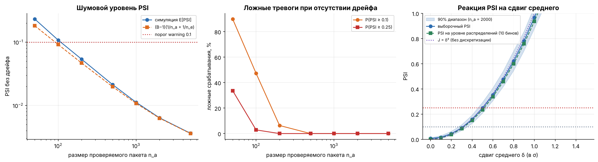
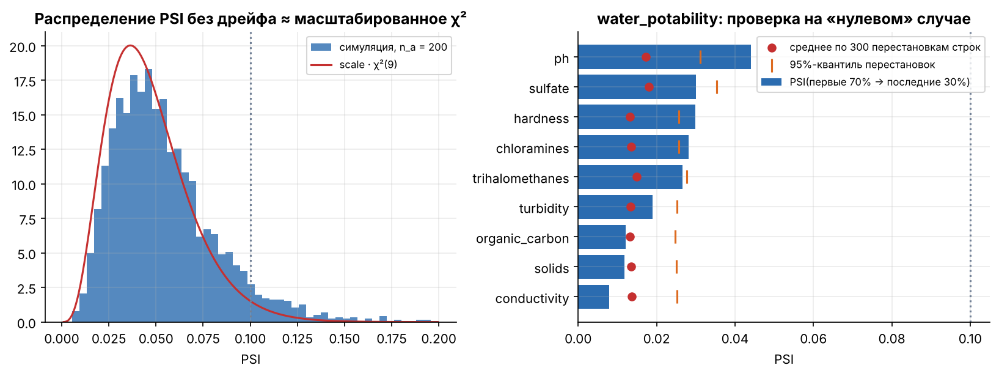

# 7. Мониторинг дрейфа: индекс стабильности популяции (PSI)

## 7.1 Постановка

После обучения модели `ModelRegistry` сохраняет для каждого признака гистограмму обучающих данных (10 равных по ширине бинов). При проверке нового пакета данных (`backend/ml/monitoring.py::monitor_batch`) для каждого признака вычисляется PSI между обучающим и новым распределением, и признак получает статус `ok`, `warning` или `alert`. Раздел формализует PSI, доказывает его основные свойства, выводит шумовой уровень и размер выборки, при которых пороги $0.1$ и $0.25$ осмысленны, и связывает пороги с физическим размером сдвига.

## 7.2 Определение (как в коде)

Пусть по обучающей выборке построены границы бинов $e_0<e_1<\dots<e_B$ ($B=10$, $e_0=\min$, $e_B=\max$ обучающих значений) и доли $E_k$ ($\sum_kE_k=1$). Для нового пакета из $n_a$ значений доля попаданий в бин $k$ равна $A_k$. Значение классифицируется по внутренним границам $e_1,\dots,e_{B-1}$ (`np.digitize`), поэтому все значения вне $[e_0,e_B]$ попадают в крайние бины и **не теряются**: $\sum_kA_k=1$. Затем обе доли ограничиваются снизу $\varepsilon=10^{-4}$:

$$
\tilde A_k=\max(A_k,\varepsilon),\quad \tilde E_k=\max(E_k,\varepsilon),\qquad
\boxed{\ \mathrm{PSI}=\sum_{k=1}^{B}(\tilde A_k-\tilde E_k)\,\ln\frac{\tilde A_k}{\tilde E_k}\ }
$$

Статус: $\mathrm{PSI}\ge0.25\Rightarrow$ `alert`; $0.1\le\mathrm{PSI}<0.25\Rightarrow$ `warning`; иначе `ok`; общий статус пакета — наихудший статус признаков.

## 7.3 Свойства

**Утверждение 7.1 (PSI — дивергенция Джеффриса).** При $\tilde A=A$, $\tilde E=E$ (отсутствии отсечки по $\varepsilon$)

$$
\mathrm{PSI}=\mathrm{KL}(A\,\Vert\,E)+\mathrm{KL}(E\,\Vert\,A),\qquad \mathrm{KL}(P\Vert Q)=\sum_kP_k\ln\frac{P_k}{Q_k}.
$$

*Доказательство.* $\sum_k(A_k-E_k)\ln\frac{A_k}{E_k}=\sum_kA_k\ln\frac{A_k}{E_k}-\sum_kE_k\ln\frac{A_k}{E_k}=\mathrm{KL}(A\Vert E)+\mathrm{KL}(E\Vert A)$. $\square$

**Утверждение 7.2 (неотрицательность и симметрия).** $\mathrm{PSI}\ge0$ всегда (в том числе при отсечке по $\varepsilon$), $\mathrm{PSI}=0$ тогда и только тогда, когда $\tilde A=\tilde E$, и $\mathrm{PSI}(A,E)=\mathrm{PSI}(E,A)$.

*Доказательство.* Каждое слагаемое $(a-e)\ln(a/e)\ge0$: логарифм монотонно возрастает, поэтому $\ln(a/e)$ и $a-e$ имеют один знак (оба положительны при $a>e$, оба отрицательны при $a<e$, оба нулевые при $a=e$). Значит сумма неотрицательна и равна нулю только если каждое слагаемое нулевое, то есть $a=e$ для всех $k$. Симметрия видна из формулы: замена $a\leftrightarrow e$ меняет знак обоих множителей. $\square$

Заметим, что доказательство через неравенство Гиббса (выпуклость $\mathrm{KL}$) требует нормировки $\sum A_k=\sum E_k=1$, которая после отсечки может нарушаться; почленное доказательство от нормировки не зависит.

**Утверждение 7.3 (малые отклонения и связь с $\chi^2$).** Пусть $A_k=E_k(1+x_k)$ с малыми $x_k$. Тогда

$$
\mathrm{PSI}\approx\sum_kE_kx_k^2=\sum_k\frac{(A_k-E_k)^2}{E_k}.
$$

*Доказательство.* $(A_k-E_k)\ln\frac{A_k}{E_k}=E_kx_k\ln(1+x_k)=E_kx_k^2-\tfrac12E_kx_k^3+\dots$; оставляем главный член. $\square$

Правая часть — статистика Пирсона, делённая на объём выборки. Отсюда следует **распределение PSI при отсутствии дрейфа**.

**Утверждение 7.4 (шумовой уровень).** Пусть новый пакет из $n_a$ значений и обучающая выборка из $n_e$ значений получены из одного распределения. Тогда при достаточно больших ожидаемых числах попаданий в бины

$$
\mathrm{PSI}\ \approx\ \Bigl(\frac1{n_a}+\frac1{n_e}\Bigr)\,\chi^2_{B-1},\qquad
\mathbb E[\mathrm{PSI}]\approx(B-1)\Bigl(\frac1{n_a}+\frac1{n_e}\Bigr).
$$

*Доказательство (схема).* Число попаданий в бин $k$ у нового пакета и у обучающей выборки — мультиномиальные векторы с одной и той же вероятностью $p_k$. Разность долей $A_k-E_k$ имеет среднее $0$ и дисперсию $p_k(1/n_a+1/n_e)$ (с учётом связи $\sum_k(A_k-E_k)=0$), поэтому $\sum_k(A_k-E_k)^2/p_k\big/(1/n_a+1/n_e)$ асимптотически $\chi^2_{B-1}$. Подстановка в утверждение 7.3 и использование $\mathbb E\,\chi^2_{B-1}=B-1$ даёт формулу. $\square$

**Практический вывод.** Шум PSI обратно пропорционален размеру пакета: чем меньше $n_a$, тем выше «фоновое» значение. Для $B=10$ порог $\mathrm{PSI}=0.1$ при $n_e\to\infty$ достигается шумом в среднем при $n_a=(B-1)/0.1=90$ наблюдениях.

## 7.4 Численная проверка шумового уровня

Симуляция: обучающая выборка $n_e=5\,000$ из $\mathcal N(0,1)$, 1 500 повторов, пакет из $n_a$ значений из того же закона; используется функция `population_stability_index` из проекта.

| $n_a$ | $\mathbb E[\mathrm{PSI}]$, симуляция | $(B-1)(1/n_a+1/n_e)$ | $P(\mathrm{PSI}\ge0.1)$ | $P(\mathrm{PSI}\ge0.25)$ | 95 %-квантиль | $\chi^2$-оценка 95 %-квантиля |
|---|---|---|---|---|---|---|
| 50 | 0.2321 | 0.1818 | **89.9 %** | **33.7 %** | 0.487 | 0.342 |
| 100 | 0.1078 | 0.0918 | **47.3 %** | 2.9 % | 0.221 | 0.173 |
| 200 | 0.0538 | 0.0468 | 6.3 % | 0 % | 0.107 | 0.088 |
| 500 | 0.0213 | 0.0198 | 0 % | 0 % | 0.042 | 0.037 |
| 1 000 | 0.0112 | 0.0108 | 0 % | 0 % | 0.021 | 0.020 |
| 2 000 | 0.0064 | 0.0063 | 0 % | 0 % | 0.0122 | 0.0118 |
| 5 000 | 0.0036 | 0.0036 | 0 % | 0 % | 0.0069 | 0.0068 |

Выводы из таблицы:

1. Для $n_a\ge500$ приближение утверждения 7.4 хорошее: расхождение среднего $8\%$ при $n_a=500$, $<4\%$ при $n_a\ge1\,000$ и $<2\%$ при $n_a\ge2\,000$.
2. Для малых пакетов формула **занижает** шум (при $n_a=50$ симуляция $0.232$ против $0.182$). Причина — малые ожидаемые числа попаданий в крайние бины (у нормального закона в крайних бинах 10-бинной гистограммы доли порядка $0.002$–$0.01$) и отсечка пустых бинов на $\varepsilon$ (раздел 7.6).
3. **При $n_a=50$ в 90 % случаев сработает `warning`, а в 34 % — `alert`, хотя дрейфа нет.** При $n_a=100$ ложный `warning` в 47 % случаев. Заметный риск ложных срабатываний исчезает примерно с $n_a\ge250$–$500$.

*Рис. 7.1. Слева: средний PSI без дрейфа против размера пакета и теоретическая формула (лог–лог). В середине: вероятность ложных `warning` и `alert` против размера пакета. Справа: реакция PSI на сдвиг среднего (выборочная, на уровне распределений и теоретическая $\delta^2$).*

*Рис. 7.2. Слева: гистограмма PSI без дрейфа при $n_a=200$ и масштабированная плотность $\chi^2_9$. Справа: PSI на реальных данных (первые 70 % → последние 30 % строк) для 9 параметров, точки — среднее по 300 случайным перестановкам строк (нулевая модель), штрихи — их 95 %-квантиль.*

## 7.5 Чувствительность к дрейфу: связь порога с размером сдвига

### Сдвиг среднего

**Теорема 7.5.** Для $P=\mathcal N(\delta,1)$ и $Q=\mathcal N(0,1)$ дивергенция Джеффриса (предел PSI при бесконечно мелких бинах) равна

$$
J=\int(p-q)\ln\frac pq\,dx=\delta^2 .
$$

*Доказательство.* $\ln\frac{p(x)}{q(x)}=\delta x-\frac{\delta^2}2$. Тогда $J=\delta\,(\mathbb E_px-\mathbb E_qx)-\frac{\delta^2}{2}(1-1)=\delta\cdot\delta=\delta^2$. $\square$

Следовательно, в пределе пороги PSI соответствуют сдвигам среднего

$$
\mathrm{PSI}=0.1\iff\delta=\sqrt{0.1}=0.316\,\sigma,\qquad
\mathrm{PSI}=0.25\iff\delta=0.5\,\sigma .
$$

**Дискретизация уменьшает PSI.** PSI по бинам — это дивергенция Джеффриса между распределениями, огрублёнными до $B$ ячеек; а любая $f$-дивергенция не возрастает при огрублении (неравенство обработки данных). Поэтому $\mathrm{PSI}_{\text{бины}}\le\delta^2$, и пороги по бинам достигаются при **чуть большем** сдвиге.

**Численные значения** (10 бинов по обучающему диапазону, $n_e=5\,000$, пакет $n_a=2\,000$, 300 повторов):

| $\delta$, в $\sigma$ | $\delta^2$ | PSI «на уровне распределений» | PSI, выборочный (среднее) |
|---|---|---|---|
| 0.0 | 0.000 | 0.000 | 0.007 |
| 0.1 | 0.010 | 0.009 | 0.016 |
| 0.2 | 0.040 | 0.037 | 0.044 |
| 0.3 | 0.090 | 0.084 | 0.091 |
| 0.4 | 0.160 | 0.150 | 0.159 |
| 0.5 | 0.250 | 0.234 | 0.249 |
| 0.6 | 0.360 | 0.337 | 0.352 |
| 0.8 | 0.640 | 0.599 | 0.620 |
| 1.0 | 1.000 | 0.937 | 0.967 |

Сдвиг, при котором PSI пересекает порог (линейная интерполяция по сетке):

| Порог | теория ($\delta=\sqrt{\text{порог}}$) | PSI на уровне распределений, 10 бинов | выборочный PSI, $n_a=2\,000$ |
|---|---|---|---|
| 0.1 (`warning`) | $0.316\sigma$ | $0.324\sigma$ | $0.313\sigma$ |
| 0.25 (`alert`) | $0.500\sigma$ | $0.515\sigma$ | $0.501\sigma$ |

Дискретизация действительно немного отодвигает порог вправо ($0.324$ и $0.515$ против $0.316$ и $0.5$), а выборочный шум ($\approx+0.006$ при $n_a=2\,000$) возвращает его обратно. Итог практический: **`warning` срабатывает при сдвиге среднего примерно на треть стандартного отклонения, `alert` — на половину**.

### Изменение разброса

Для $\mathcal N(0,1)$ против $\mathcal N(0,r^2)$ дивергенция Джеффриса равна

$$
J(r)=\frac{(r^2-1)^2}{2r^2} .
$$

(Складываем $\mathrm{KL}=\ln r+\frac1{2r^2}-\frac12$ и обратную $\mathrm{KL}=-\ln r+\frac{r^2}{2}-\frac12$.) Пороги достигаются при $J=0.1$: $u=r^2$ решает $u^2-2.2u+1=0$, откуда $r=1.248$; при $J=0.25$: $u^2-2.5u+1=0$, $u=2$, $r=\sqrt2=1.414$. То есть **`warning` — рост разброса на 25 %, `alert` — на 41 %.**

Проверка: при $r=1.2$ формула даёт $J=0.067$, выборочный PSI (10 бинов, $n_a=2\,000$) равен $0.067$; при $r=1.3$ формула $J=0.141$, выборочный $0.135$ (чуть ниже из-за огрубления); при $r=1.5$ формула $J=0.347$, выборочный $0.315$. Все выборочные значения не превосходят теоретических $J$ (с точностью до шума), как и должно быть по неравенству обработки данных.

## 7.6 Отсечка по $\varepsilon$ и пустые бины

Если в новом пакете нет ни одного значения в бине с ожидаемой долей $E_k=e$, то слагаемое равно $(e-\varepsilon)\ln(e/\varepsilon)$:

| Ожидаемая доля бина $e$ | вклад пустого бина в PSI |
|---|---|
| 0.20 | 1.519 |
| 0.10 | 0.690 |
| 0.05 | 0.310 |
| 0.02 | 0.105 |
| 0.01 | 0.046 |

**Следствие.** Одного пустого бина с ожидаемой долей $\ge0.05$ достаточно для `alert` ($0.31>0.25$), а долей $\ge0.02$ — для `warning`. Для небольших пакетов (десятки значений) это ключевая причина ложных срабатываний из таблицы 7.4: при $n_a=50$ ожидаемое число значений в бине с $E_k=0.02$ равно $1$, и вероятность пустого бина $(1-0.02)^{50}=36\%$. Значение $\varepsilon=10^{-4}$ — компромисс: меньшее $\varepsilon$ ещё сильнее наказывает пустые бины (вклад растёт как $e\ln(e/\varepsilon)$), большее — ослабляет чувствительность к полному исчезновению диапазона значений.

## 7.7 Проверка на реальных данных

В `water_potability` нет времени, поэтому проверяется «нулевой» случай: PSI между первыми 70 % и последними 30 % строк (порядок строк не имеет временного смысла). Для каждого параметра дополнительно построено нулевое распределение по 300 случайным перестановкам строк.

| Параметр | PSI (70→30 %) | среднее по перестановкам | 95 %-квантиль перестановок | перестановочное $p$ |
|---|---|---|---|---|
| ph | 0.0441 | 0.0173 | 0.0312 | 0.017 |
| hardness | 0.0298 | 0.0131 | 0.0257 | 0.023 |
| solids | 0.0119 | 0.0136 | 0.0250 | 0.565 |
| chloramines | 0.0282 | 0.0136 | 0.0256 | 0.040 |
| sulfate | 0.0301 | 0.0181 | 0.0354 | 0.116 |
| conductivity | 0.0079 | 0.0137 | 0.0252 | 0.814 |
| organic_carbon | 0.0121 | 0.0132 | 0.0247 | 0.522 |
| trihalomethanes | 0.0266 | 0.0149 | 0.0277 | 0.076 |
| turbidity | 0.0190 | 0.0134 | 0.0252 | 0.183 |

1. Все девять значений PSI меньше $0.05$, то есть статус `ok` по любым порогам ($<0.1$).
2. Нулевой уровень по перестановкам ($0.013$–$0.018$) близок к формуле 7.4: для `ph` $(B-1)(1/836+1/1949)=0.0154$ против $0.0173$ по перестановкам. Совпадение подтверждает, что теоретическая оценка шума применима и к реальным (не нормальным) распределениям.
3. У трёх параметров (`ph`, `hardness`, `chloramines`) PSI выше 95 %-квантиля перестановок ($p=0.017,\,0.023,\,0.040$). Девять параллельных проверок делают это ожидаемым: при $\alpha=0.05$ в среднем $0.45$ ложных срабатываний, а с поправкой Бонферрони ($\alpha=0.0056$) значимых нет. Практически: различия слишком малы, чтобы влиять на статус, и это **не** дрейф.

## 7.8 Вывод для работы

1. PSI — дивергенция Джеффриса между огрублёнными распределениями; она неотрицательна и симметрична (утверждения 7.1–7.2).
2. Фоновое значение PSI без дрейфа равно примерно $(B-1)(1/n_a+1/n_e)$ и сильно зависит от размера пакета: при $n_a\le100$ пороги $0.1$ и $0.25$ срабатывают ложно в 47–90 % и 3–34 % случаев; для надёжной работы нужен пакет не менее $\approx250$–$500$ значений.
3. Пороги PSI имеют ясный физический смысл: `warning` — сдвиг среднего на $0.32\sigma$ или рост разброса на 25 %, `alert` — на $0.5\sigma$ или на 41 %.
4. Реальные данные согласуются с теорией: PSI между частями набора находится на шумовом уровне и не превышает $0.045$.

## 7.9 Ограничения

- PSI измеряет различие маргинальных распределений по признакам и не видит изменения совместной структуры (изменение корреляции при тех же маргиналах даёт $\mathrm{PSI}=0$, как в теореме 5.1).
- Границы бинов фиксируются по обучающему диапазону $[\min,\max]$; одно выбросное значение в обучении растягивает диапазон и размывает остальные бины (почти все значения попадают в центральные бины, а крайние бины практически пусты). Квантильные бины (равные доли) устраняют эту проблему и дают лучшие свойства (ожидаемые доли $E_k=1/B$ одинаковы), но в коде используются равные по ширине.
- Пороги $0.1$ и $0.25$ эвристические (пришли из кредитного скоринга), для эксплуатации их стоит уточнять по размеру пакета (п. 7.4).
- Теоретические формулы 7.4 и 7.5 выведены для нормальных данных; на других распределениях они задают порядок величины, а не точные значения.
